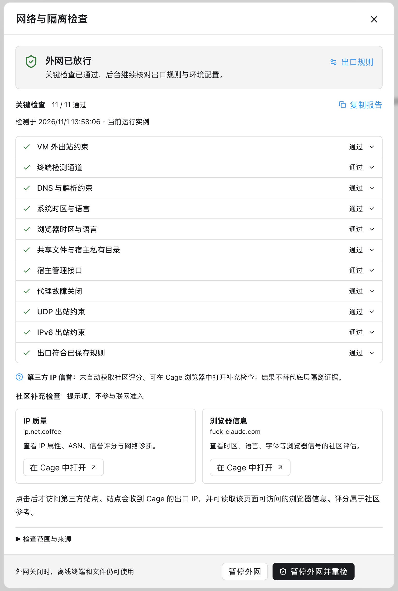
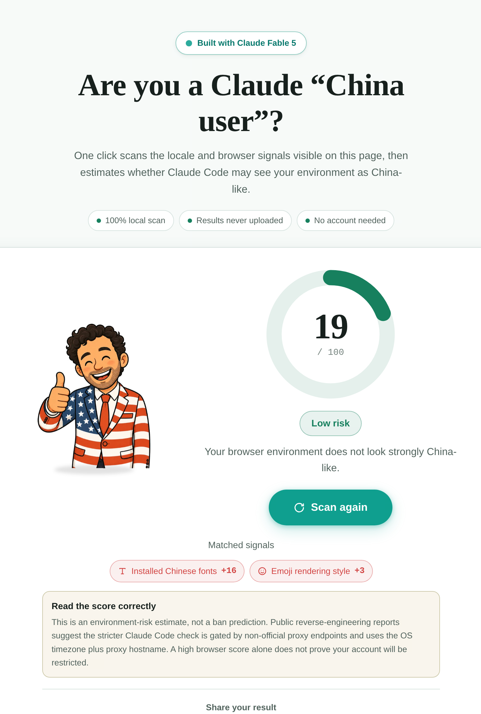
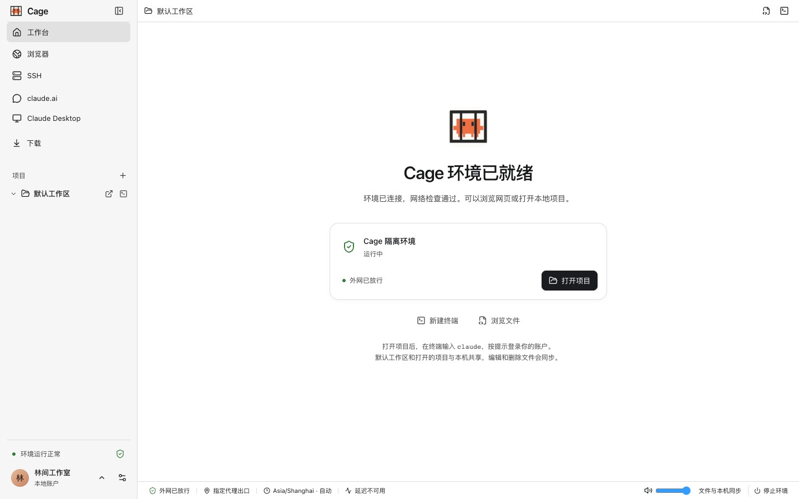

<div align="center">

<h1>Claude 防封</h1>

**Miss Claude ကို လှောင်အိမ်ထဲတွင် ထားပါ၊ ထို့ကြောင့် ကျွန်ုပ်တို့၏အချိန်များကို အတူတကွ ပိုမိုကောင်းမွန်စွာ ကာကွယ်နိုင်မည်ဖြစ်သည်။**


[](https://github.com/tan396222-prog/Claude-AntiBan/releases) [](https://github.com/tan396222-prog/Claude-AntiBan/actions/workflows/ci.yml) [](LICENSE)

**[ပရောဂျက်ဝက်ဘ်ဆိုက်](https://github.com/tan396222-prog/Claude-AntiBan) · [အက်ပ်ကို ဒေါင်းလုဒ်လုပ်ရန်](https://github.com/tan396222-prog/Claude-AntiBan/releases) · [စတင်လုပ်ဆောင်ခြင်း။](docs/getting-started.md) · [FAQ](docs/troubleshooting.md) · [အသုံးပြုမှုလမ်းညွှန် (တရုတ်ဘာသာ)](docs/README.md)**

[简体中文](README.md) · [繁體中文](README.zh-TW.md) · [Русский](README.ru.md) · [العربية](README.ar.md) · [فارسی](README.fa.md) · [한국어](README.ko.md) · [Español](README.es.md) · [မြန်မာဘာသာ](README.my.md) · [Беларуская](README.be.md) · [پښتو](README.ps.md) · [دری](README.prs.md) · [አማርኛ](README.am.md) · [Soomaali](README.so.md) · [ትግርኛ](README.ti.md) · [Français](README.fr.md)

</div>

## Anthropic ကို စိတ်ကုန်နေပြီ

Claude နှင့် စကားပြောပြီး ပူးပေါင်းလိုသည့် သာမန်အသုံးပြုသူများအနေဖြင့် VPS ဖြစ်ရပ်များ၊ ဘရောက်ဆာလက်ဗွေရာပရိုဖိုင်များနှင့် ပတ်ဝန်းကျင်စစ်ဆေးမှုများကို ပြင်ဆင်ရာတွင် ငြီးငွေ့နေပြီး အကောင့်ပိတ်ပင်မှုနှင့် ငွေကြေးဆုံးရှုံးမှုများအတွက် စိုးရိမ်နေပါသည်။ ကျွန်တော်တင်ပြတယ်။ **Claude 防封** — **အဆင်သင့်အသုံးပြုနိုင်သော ဒက်စတော့အပလီကေးရှင်း- သင့်ကိုယ်ပိုင်ကွန်ရက်ပရောက်စီကို စီစဉ်သတ်မှတ်ပြီး သင်၏ သီးခြားပတ်ဝန်းကျင်၊ အချိန်ဇုန်၊ ဘာသာစကားနှင့် ပတ်ဝန်းကျင်စစ်ဆေးမှုများကို တစ်နေရာတည်းတွင် စီမံခန့်ခွဲပါ။**

Claude 防封 သည် terminal၊ browser၊ editor နှင့် တရားဝင် Claude Desktop ကို သီးခြားအလုပ်ခွင်တစ်ခုတွင် စုစည်းပေးသည်။ Mac တွင် macOS virtual machine၊ လိုအပ်ချက်ပြည့်မီသော Windows ကွန်ပျူတာတွင် Windows သို့မဟုတ် ပေါ့ပါးသော Linux ပတ်ဝန်းကျင်ကို အသုံးပြုနိုင်သည်။ ရွေးချယ်ထားသော project များကိုသာ မျှဝေပြီး ကွန်ရက်ကို သီးခြားစီမံပါ။ ကိုယ်ပိုင် server ကို SSH ဖြင့် ချိတ်ဆက်နိုင်ပြီး ဖုန်းမှလည်း အလုပ်ဆက်လုပ်နိုင်သည်။ အဓိကလုပ်ဆောင်ချက်များမှာ—

- ကွန်ရက်ဆက်တင်များကို လက်ခံဆောင်ရွက်ပေးသူမှ သီးခြားခွဲထားသည်။ Cage သည် ၎င်း၏ပတ်ဝန်းကျင်အတွင်းရှိ ကွန်ရက်အသွားအလာအားလုံးကို ၎င်း၏ကိုယ်ပိုင်ကွန်ရက် proxy မှတစ်ဆင့် လမ်းကြောင်းပေးသည်။
- အချိန်ဇုန်နှင့် ဘာသာစကားအပါအဝင် ကွန်ရက်ပရောက်စီ၏ IP တည်နေရာသို့ အလိုအလျောက်ထပ်တူပြုခြင်းဖြင့် ဘရောက်ဆာလက်ဗွေဆက်တင်များကို ခွဲထုတ်ထားသည်။
- Claude အလုပ်အသွားအလာတစ်လျှောက် ပေါင်းစည်းခြင်း- ဘရောက်ဆာ အကောင့်ဝင်ခြင်း၊ အကောင့်ခွင့်ပြုချက်နှင့် Claude Code လုပ်ငန်းစဉ်
- အရေးကြီးသောစစ်ဆေးမှုများ ပျက်ကွက်ခြင်း သို့မဟုတ် အထောက်အထား မပြည့်စုံသောအခါတွင် ထည့်သွင်းထားသော ကွန်ရက်နှင့် သီးခြားစစ်ဆေးခြင်းများသည် အင်တာနက် အသုံးပြုခွင့်ကို ခေတ္တရပ်ထားသည်။ အသိုင်းအဝိုင်းနှင့် ပြင်ပအဖွဲ့အစည်း စစ်ဆေးမှုများသည် ထပ်လောင်းကိုးကားသည့် အချက်အလက်ကို ပေးပါသည်။

**Cage ဖြင့် ပတ်ဝန်းကျင်စစ်ဆေးမှုရလဒ်များ**

| ကွန်ရက်နှင့် သီးခြားခွဲထားမှု စစ်ဆေးချက်များ | အသိုင်းအဝိုင်း၏ ဘရောက်ဇာ စစ်ဆေးချက် |
| :---: | :---: |
| <a href="assets/network-checks.png"></a> | <a href="assets/community-browser-check.png"></a> |

**Cage ၏ အဓိက အင်တာဖေ့စ်**



## Cage နဲ့ သင်ဘာလုပ်နိုင်လဲ။

- **ပြတင်းပေါက်တစ်ခုတည်းတွင် အလုပ်လုပ်ပါ။** Terminal တွင် Claude ကုဒ်ကိုဖွင့်ပါ၊ တည်းဖြတ်သူရှိပြောင်းလဲမှုများကိုစစ်ဆေးပါ၊ ဝန်ဆောင်မှုများကိုအစမ်းကြည့်ရှုရန်နှင့် လက်မှတ်ထိုးဝင်ရန်အတွက် Cage ဘရောက်ဆာကိုအသုံးပြုပါ။
- **ရင်းနှီးပြီးသားစနစ်တွင် ဖန်တီးပါ။** macOS၊ Windows သို့မဟုတ် Linux ဧည့်သည်စနစ်နှင့် သက်ဆိုင်ရာကိရိယာများကို ရွေးပါ၊ သို့မဟုတ် မူရင်းစနစ်ကို ပုံတူဖန်တီးပြီး သန့်ရှင်းသော သီးခြားပတ်ဝန်းကျင်တစ်ခု တည်ဆောက်ပါ။ [Guest စနစ်ရွေးချယ်ခြင်း](docs/guide/guest-systems.md)
- **သင်မျှဝေသောအရာကို ထိန်းချုပ်ပါ။** ပုံသေအလုပ်ခွင်နှင့် အတိအလင်းဖွင့်ထားသော ပရောဂျက်ဖိုင်တွဲများကိုသာ မျှဝေပါသည်။ လက်ခံသူ၏ Claude အကောင့်ဝင်ခြင်းအခြေအနေ၊ ဘရောက်ဆာပရိုဖိုင်များနှင့် SSH ကီးများကို အလိုအလျောက် ထည့်သွင်းမည်မဟုတ်ပါ။
- **သင်၏ကွန်ရက်အခြေအနေကိုကြည့်ပါ။** Built-in ကွန်ရက် proxy စီမံခန့်ခွဲမှုသည် သင့်အား စာရင်းသွင်းမှုများကို တင်သွင်းရန်၊ အဆုံးမှတ်များကို ရွေးချယ်ကာ ထွက်ပေါက် IP ကို ​​စစ်ဆေးနိုင်စေပါသည်။ အရေးကြီးသောစစ်ဆေးမှုများမပြီးမချင်း ပတ်ဝန်းကျင်သည် အော့ဖ်လိုင်းဖြစ်နေသည်။ ကွန်ရက်ပရောက်စီကို မရရှိနိုင်ပါက၊ တိုက်ရိုက်ချိတ်ဆက်မှုသို့ ပြန်လှည့်စရာမရှိပါ။
- **နောက်တစ်ကြိမ် ဆက်ရန်။** ကိရိယာများ၊ ဖိုင်များနှင့် အကောင့်ဝင်ခြင်းအခြေအနေသည် virtual disk ပေါ်တွင် ဆက်လက်ရှိနေပါသည်။ ဝင်းဒိုးကိုပိတ်သည့်အခါ နောက်ခံလုပ်ဆောင်စရာများကို ဆက်လက်လုပ်ဆောင်နိုင်သည်။
- **Claude Code အကောင့်များစွာကို စီမံပါ။** အသုံးပြုခွင့်ပမာဏကို ကြည့်ပါ၊ session အသစ်များအတွက် အကောင့်ခွဲဝေပါ၊ တိကျစွာခွင့်ပြုပြီးနောက် အကောင့်ပြောင်း၍ မှတ်တမ်းကို ဆက်သုံးပါ။ [Claude Code](docs/guide/accounts.md)
- **ဖုန်းမှ အလုပ်ဆက်လုပ်ပါ။** Android သို့မဟုတ် iPhone ကို QR သို့မဟုတ် pairing code ဖြင့် ကွန်ပျူတာနှင့် ချိတ်ဆက်ပါ။ တူညီသော Claude Code စကားဝိုင်းကို ဆက်လုပ်ခြင်း၊ စာပို့ခြင်း၊ ကိရိယာအသုံးပြုမှုကို ခွင့်ပြုခြင်း၊ remote browser နှင့် ကွန်ပျူတာရှိ Claude Desktop ဝင်းဒိုးကို အသုံးပြုခြင်းတို့ ပြုလုပ်နိုင်သည်။
- **Cage ကို cloud ပေါ်တွင် အသုံးပြုပါ။** လိုအပ်ချက်နှင့်ကိုက်ညီသော Linux x86_64 VPS တွင် Cage ကို တပ်ဆင်ပြီး SSH ဖြင့် ချိတ်ဆက်ပါ။ KVM မလိုအပ်ပါ။ ဒေတာနှင့် ကွန်ရက်ထွက်ပေါက်သည် server ပေါ်တွင် ရှိသည်။
- **ကိုယ်ပိုင်ကွန်ရက်ဖြင့် ချိတ်ဆက်ပါ။** Cage ထဲတွင် Tailscale ဝင်ပြီး မူရင်းကွန်ပျူတာနှင့် ပတ်ဝန်းကျင်အကြား နှစ်ဖက် SSH ချိတ်ဆက်ပါ။ [Tailscale / SSH](docs/guide/tailscale.md)

## အမြန်စတင်ပါ။

ဤတောင်းဆိုချက်ကို သင်၏ AI အေးဂျင့် (codex၊ dsh၊ workbuddy — Claude Code ဖြစ်နိုင်သည် 😁) ။

```markdown
တပ်ဆင်ကူညီပေးပါ။ https://github.com/tan396222-prog/Claude-AntiBan ကျွန်ုပ်၏စက်တွင်း Clash တပ်ဆင်မှုတွင် xxx အဆုံးမှတ်ကို အသုံးပြုရန် Cage ၏ကွန်ရက်ပရောက်စီကို စီစဉ်သတ်မှတ်ပါ။
```

သင်လိုအပ်သည်မှာ ယုံကြည်စိတ်ချရသော ကွန်ရက် proxy အဆုံးမှတ်တစ်ခုဖြစ်သည်။ ဤပရောဂျက်သည် မည်သည့်ပရောက်စီဝန်ဆောင်မှုပေးသူကိုမျှ မြှင့်တင်မည်မဟုတ်ပါ။ ဥပမာအားဖြင့် Black Error ဝဘ်ဆိုက်ကို ရှာဖွေခြင်းဖြင့် ပံ့ပိုးပေးသူကို သင်ကိုယ်တိုင် ရှာဖွေနိုင်သည်။

## ဒေါင်းလုဒ်လုပ်ပြီး တပ်ဆင်ပါ။

Cage သည် macOS၊ Windows နှင့် Linux ကို ပံ့ပိုးသည်။ macOS 14+ ရှိ Apple Silicon Mac၊ Windows 10 22H2 / 11 x64 နှင့် Debian 12 / Ubuntu 22.04 / 24.04 x86_64. Intel Mac၊ Windows ARM64 နှင့် Linux ARM64 ကို မပံ့ပိုးသေးပါ။ [macOS](docs/getting-started.md) · [Windows](docs/windows.md) · [Linux](docs/linux.md).

1. အက်ပ်ကို ဒေါင်းလုဒ်လုပ်ရန်: [macOS / Windows / Linux](https://github.com/tan396222-prog/Claude-AntiBan/releases).
2. macOS: တပ်ဆင်မှုပက်ကေ့ချ်ကိုဖွင့်ပြီး ဆွဲယူပါ။ **Cage** ထဲသို့ **အသုံးချမှု**; ထို့နောက် ၎င်းကို Applications မှ စတင်လိုက်ပါ။ Windows: [တပ်ဆင်နည်း](docs/windows.md#安装并开始工作) · Linux: [တပ်ဆင်နည်း](docs/linux.md#安装并开始工作).
3. သင့်ကိုယ်ပိုင်ကွန်ရက်ပရောက်စီကို စီစဉ်သတ်မှတ်ရန်၊ ပတ်ဝန်းကျင်ကို စတင်ရန်နှင့် ပရောဂျက်တစ်ခုဖွင့်ရန် အက်ပ်အတွင်း ညွှန်ကြားချက်များကို လိုက်နာပါ။

တပ်ဆင်ဖိုင်တွင် အလုပ်ခွင်နှင့် proxy engine ပါဝင်သည်။ Go၊ Node.js၊ Docker သို့မဟုတ် Clash ကို ကြိုတင်တပ်ဆင်ရန် မလိုပါ။ ပတ်ဝန်းကျင်ဖန်တီးချိန်တွင် guest စနစ်နှင့် သိမ်းဆည်းရာနေရာကို ရွေးပြီး တရားဝင် image နှင့် ကိရိယာများကို ပြင်ဆင်ပါ။ Cage သည် OS လိုင်စင်၊ proxy ဝန်ဆောင်မှု သို့မဟုတ် Claude အကောင့် မပေးပါ။

မူရင်းကုဒ်နှင့် တပ်ဆင်ဖိုင်များကို အများပြည်သူရယူနိုင်သည်။ ဗားရှင်းမှတ်စုနှင့် checksum များကို [Releases](https://github.com/tan396222-prog/Claude-AntiBan/releases) တွင် ကြည့်ပါ။

လုပ်ဆောင်ချက်များသည် အသုံးပြုသော build ပေါ်မူတည်သည်။ အများပြည်သူ installer ၏ စွမ်းရည်နှင့် စမ်းသပ်မှုနယ်ပယ်ကို release မှတ်စုတွင် ကြည့်ပါ။

macOS နှင့် လက်မှတ်ထိုးထားသော Windows ကို ရွေးထားသော proxy ဖြင့် update လုပ်နိုင်သည်။ လက်မှတ်မထိုးထားသော Windows preview နှင့် Linux ကို installer ဖြင့် ကိုယ်တိုင် update လုပ်ပါ။ အရင်ဆုံး အလုပ်ကိုသိမ်းပြီး ရပ်ပါ။ ကိုယ်ရေးဒေတာကို ဆက်ထိန်းထားသည်။ [အပ်ဒိတ်နှင့် ဖယ်ရှားခြင်း](docs/guide/maintenance.md)

## အဆင့်သုံးဆင့်ဖြင့် စတင်လိုက်ပါ။

### 1. ကွန်ရက်ပရောက်စီကို ရွေးပါ။

ပင်မစာမျက်နှာတွင် 'ကွန်ရက်နှင့် ပရောက်စီကို သတ်မှတ်ပါ'၊ ထို့နောက် 'ရင်းမြစ်ကို ထည့်ပါ' ကို နှိပ်ပါ။ Clash/Mihomo YAML စာရင်းသွင်းမှု သို့မဟုတ် ဒေသတွင်း YAML ဖိုင်ကို တင်သွင်းပြီး 'Nodes' အောက်ရှိ အဆုံးမှတ်ကို ရွေးချယ်ပါ။ ကွန်ရက်ပရောက်စီကို မရရှိနိုင်ပါက၊ သင်သည် 'ဤစာရင်းသွင်းမှုကို လက်ခံဆောင်ရွက်ပေးသည့်ကွန်ရက်မှတစ်ဆင့် ဒေါင်းလုဒ်လုပ်ပါ' သို့မဟုတ် ဒေသတွင်းဖိုင်ကို တိုက်ရိုက်တင်သွင်းနိုင်သည်။ နောက်ပိုင်းတွင်၊ 'ဆက်တင်များ → ကွန်ရက်နှင့် ပရောက်စီ' အောက်တွင် အဆုံးမှတ်များကို စီမံပါ။

### 2. ပတ်ဝန်းကျင်ကို စတင်ပါ။

ပထမဆုံးဖန်တီးချိန်တွင် ဧည့်သည်စနစ် သို့မဟုတ် မူရင်းစနစ်ပုံတူနှင့် သိမ်းဆည်းမည့်နေရာကို ရွေးပါ။ Cage ပတ်ဝန်းကျင်ကို စတင်ပြီး တပ်ဆင်မှုနှင့် ခွင့်ပြုချက်လမ်းညွှန်ကို လိုက်နာပါ။ လုပ်ဆောင်မှုအသေးစိတ်တွင် တိုးတက်မှုနှင့် အမှားများကို ကြည့်နိုင်သည်။ နောက်တစ်ကြိမ်တွင် ပတ်ဝန်းကျင်ဟောင်းကို ပြန်သုံးသည်။

### 3. ပရောဂျက်တစ်ခုကိုဖွင့်ပြီး Claude ကိုဖွင့်ပါ။

သင့် ကွန်ပျူတာ တွင် ဖိုင်တွဲတစ်ခုကို ရွေးချယ်ရန်၊ terminal အသစ်တစ်ခုဖွင့်ပြီး ဝင်ရောက်ရန် 'Open project' ကိုနှိပ်ပါ။ `claude`; ထို့နောက် Cage browser တွင် သင့်ကိုယ်ပိုင်အကောင့်ကို ခွင့်ပြုပါ။ ပရောဂျက်ကို မပြင်ဆင်ဘဲ မူလအလုပ်နေရာနှင့်လည်း စတင်နိုင်သည်။ အဆင့်များ အပြည့်အစုံကို ကြည့်ပါ။ [စတင်လုပ်ဆောင်ခြင်း။](docs/getting-started.md).

## အသုံးမပြုမီ ဤကန့်သတ်ချက်များကို နားလည်ပါ။

- မျှဝေထားသော ပရောဂျက်များတွင် တည်းဖြတ်မှုများနှင့် ဖျက်ခြင်းများသည် သင့် ကွန်ပျူတာ ရှိ ဖိုင်များကို တိုက်ရိုက်အကျိုးသက်ရောက်သည်။ ဗားရှင်းထိန်းချုပ်မှု သို့မဟုတ် အရန်သိမ်းဆည်းမှုများကို အသုံးပြုပါ။ပရောဂျက်၏ `.git` ကို ဖတ်ရှုရေးသားနိုင်ပြီး Cage အတွင်း ပြောင်းလဲမှုများကို stage လုပ်ခြင်း၊ commit လုပ်ခြင်းနှင့် branch ပြောင်းခြင်းတို့ ပြုလုပ်နိုင်သည်။
- ပရောဂျက်အားလုံးသည် ၎င်း၏ကိရိယာများ၊ အကောင့်များနှင့် macOS / Windows / Debian / Ubuntu 22.04 ဖိုင်စနစ်အပါအဝင် Cage ဝန်းကျင်တစ်ခုကို မျှဝေသည်။ ပရောဂျက်များသည် တစ်ခုနှင့်တစ်ခု သီးခြားခွဲထားခြင်းမရှိပေ။
- မူလအနေဖြင့် အင်တာနက်အထွက်သည် IPv4 TCP ကို ပံ့ပိုးပြီး DNS သည် တူညီသော proxy ကို သုံးသည်။ အများသုံး UDP၊ IPv6၊ ICMP နှင့် မူရင်းကွန်ပျူတာ သို့မဟုတ် LAN သို့ တိုက်ရိုက်ချိတ်ဆက်မှုကို ကန့်သတ်ထားသည်။ Tailscale ကို ကိုယ်တိုင်ဖွင့်ပါက ကိုယ်ပိုင်ကွန်ရက်ခွင့်ပြုချက်အတိုင်း စက်များကို ချိတ်ဆက်နိုင်သည်။
- ကွန်ရက်စစ်ဆေးမှုများသည် လက်ရှိဖွဲ့စည်းပုံနှင့် နမူနာပုံသက်သေကို ပြသသည်။ အကောင့်တစ်ခုသည် ပလပ်ဖောင်းကန့်သတ်ချက်များကို ရှောင်ရှားနိုင်မည်ဟု အာမခံမပေးနိုင်ပါ။ ၎င်းတို့သည် ပြီးပြည့်စုံသော virtualization လုံခြုံရေးစစ်ဆေးမှုကို အစားထိုးမည်မဟုတ်ပါ။

အသေးစိတ်ကို ကြည့်ပါ။ [ကွန်ရက်နှင့် ဒေတာနယ်နိမိတ်များ](docs/getting-started.md#网络与数据边界).

## စာရွက်စာတမ်းများနှင့် ပံ့ပိုးမှုများ

အညွှန်းအပြည့်အစုံကို ကြည့်ပါ။ [စာရွက်စာတမ်းအညွှန်း](docs/README.md).

| မင်းရဲ့တာဝန် | ဤနေရာတွင် စတင်ပါ။ |
|---|---|
| macOS / Windows / Debian / Ubuntu 22.04 | [Guest စနစ်ရွေးချယ်ခြင်း](docs/guide/guest-systems.md) |
| ထည့်သွင်းပါ၊ ကွန်ရက်ပရောက်စီကို စီစဉ်သတ်မှတ်ပါ၊ သင်၏ပထမဆုံးပရောဂျက်ကိုဖွင့်ပါ။ | [စတင်လုပ်ဆောင်ခြင်း။](docs/getting-started.md) |
| ဒေါင်းလုဒ်များ၊ စတင်ခြင်း၊ ချိတ်ဆက်မှုနှင့် လက်မှတ်ထိုးဝင်ခြင်းတို့ကို ပြဿနာဖြေရှင်းပါ။ | [FAQ နှင့် ပြန်လည်ရယူခြင်း။](docs/troubleshooting.md) |
| ကီးဘုတ်ထိန်းချုပ်မှုများ၊ အသွင်အပြင်၊ ဒေတာ ခိုင်မြဲမှုနှင့် ထွက်ပေါက်အပြုအမူတို့ကို လေ့လာပါ။ | [နေ့စဉ်အသုံးပြုခြင်း။](docs/getting-started.md#日常使用) |
| မျိုးပွားနိုင်သော ပြဿနာကို သတင်းပို့ပါ။ | [GitHub Issues](https://github.com/tan396222-prog/Claude-AntiBan/issues) |

ပရောဂျက်က အရှိန်အဟုန်နဲ့ တိုးတက်နေတယ်။ တုံ့ပြန်ချက်မျှဝေရန် ကွန်မြူနတီအဖွဲ့သို့ ဝင်ရောက်ပါ။ ရပ်ရွာထိန်းသိမ်းသူ များကို ကြိုဆိုပါတယ်။

## မူရင်းနှင့်လိုင်စင်

Cage မှ ဆင်းသက်လာသည်။ [agent-vm](https://github.com/sylvinus/agent-vm).

ပရောဂျက်ရဲ့ အဓိက လိုင်စင်ကတော့ [MIT](LICENSE). အစုလိုက်အစည်းလိုက် အစိတ်အပိုင်းများသည် ၎င်းတို့၏ သက်ဆိုင်ရာလိုင်စင်များကို ဆက်လက်ထိန်းသိမ်းထားသည်။ Mihomo ကို GPL-3.0 အောက်တွင် သီးခြားလုပ်ဆောင်နိုင်သော လုပ်ဆောင်ချက်အဖြစ် ဖြန့်ဝေထားသည်။ ကြည့်လည်းကြည့် [NOTICE](NOTICE) · [Third-party လိုင်စင်များ](THIRD_PARTY_LICENSES) · [noVNC](ui/vendor/novnc/LICENSE.txt)。

Cage သည် လွတ်လပ်သောအသိုင်းအဝိုင်းပရောဂျက်တစ်ခုဖြစ်ပြီး Anthropic နှင့် မသက်ဆိုင်ပါ။

## အကိုးအကားများနှင့် အသိအမှတ်ပြုချက်များ

အခြေခံစွမ်းရည်များနှင့် ဒီဇိုင်းကိုးကားချက်များအတွက် အောက်ပါပရောဂျက်များကို ကျေးဇူးတင်ပါသည်။

- [agent-vm](https://github.com/sylvinus/agent-vm): ရေဆန်အုတ်မြစ်ကေ့။
- [Lima](https://github.com/lima-vm/lima): Linux virtual machine စီမံခန့်ခွဲမှု။
- [gvisor-tap-vsock](https://github.com/containers/gvisor-tap-vsock): virtual machine ကွန်ရက်ချိတ်ဆက်ခြင်း။
- [sshocker](https://github.com/lima-vm/sshocker) နှင့် [SFTP](https://github.com/pkg/sftp): virtual machine နှင့် host အကြား ဖိုင်မျှဝေခြင်း။
- [noVNC](https://github.com/novnc/noVNC) − ဘရောက်ဆာရှိ အဝေးထိန်းပြသမှုနှင့် အပြန်အလှန်တုံ့ပြန်မှု။
- [Mihomo](https://github.com/MetaCubeX/mihomo) − တပ်ဆင်ထားသော ကွန်ရက် ပရောက်စီ အူတိုင်။
- [code-server](https://github.com/coder/code-server) - ဘရောက်ဆာအခြေခံကုဒ်တည်းဖြတ်သူ။
- [AIO Sandbox](https://github.com/agent-infra/sandbox): လုပ်ငန်းခွင်ပတ်ဝန်းကျင်နှင့် အပြန်အလှန်အကျိုးပြုမှုဒီဇိုင်းအတွက် ကိုးကားချက်များ။
- [claude-switcher](https://github.com/YOURSJEYO/claude-switcher) နှင့် [Claude-Guardian](https://github.com/DUNHKpcc/Claude-Guardian): ကွန်ရက်စစ်ဆေးမှုများနှင့် လုံခြုံရေးဆိုင်ရာ စစ်ဆေးမှုများအတွက် ကိုးကားချက်များ။

