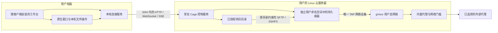

# 云服务器部署与桌面远程连接

Cage 可以把工作环境放在用户自己的 Linux 服务器上。本地电脑显示同一套工作台，负责键盘、输入法、剪贴板和明确选择的文件传输；服务器运行终端、浏览器、编辑器与 Claude Desktop，并保存项目、账户和网络配置。目标服务器无需 KVM，采用 rootless 容器运行环境。

本文面向维护者，说明本地与云端如何协作、数据保存在哪里，以及必须验证的边界。服务器前提和安装步骤见[部署说明](../../deploy/cloud/README.md)。

## 从本地进入云端工作台

用户在工作台左侧栏打开“SSH”，添加服务器名称、SSH 地址、端口、用户名和本机密钥文件或 SSH agent。自定义安装可在“云端安装路径”填写服务器上的程序和配置路径。首次连接需要核对 SSH 主机指纹；指纹变化时停止连接，要求重新核对。密钥口令只参与本次连接，不保存到主机配置。

SSH 身份验证完成后，客户端检测云端 Cage。已就绪的服务直接连接，已停止且能确认归属的用户服务自动启动。空配置目录须由用户点击「部署并连接」，客户端才上传程序和安装脚本。服务器准备独立的 rootless 引擎，从 Debian 基础镜像安装工作环境。云端就绪后，客户端取得一次性入口，在连接服务内换取会话。工作台随后显示服务器的账户解锁页。打开项目时选择服务器目录；上传仍使用本机文件选择器；下载记录区分服务器文件与已经另存到本机的副本。客户端始终显示当前主机，避免在错误的环境操作。

同一个 Cage 应用提供本机与 SSH 两种运行方式。选择 SSH 时在左栏管理连接，打开应用默认进入本机首页，本机虚拟机由用户手动启动。本机存在运行中的环境或任务时，连接卡片提供停止、保留与取消。进程与数据归属见[桌面入口与资源设计](desktop-environments.md)。SSH 连接由客户端内置的 Go 实现负责，三个平台复用各自的原生窗口、文件选择器、剪贴板和输入法。Windows 需要 WebView2，Linux 需要 GTK/WebKitGTK。

## 整体关系

云端控制服务保持回环监听，SSH 承担加密连接与主机身份验证。浏览器、桌面、声音和终端复用现有业务协议，不分别开放公网端口。本地只代理业务 API，不加载云端提供的工作台 HTML 或脚本；原生桥仍只接受本地受认证页面的调用。

## 谁保存什么

| 数据或操作 | 本地电脑 | 云服务器 |
| --- | --- | --- |
| 服务器连接配置 | 私有 `remote-hosts.json`；不保存密钥内容和口令 | 不保存客户端私钥 |
| 项目与工具 | 只保存用户明确下载的副本 | 持久项目目录及完整容器文件系统 |
| Cage 账户、浏览器资料、保险箱 | 提供解锁与使用界面 | 当前服务器配置的真源 |
| 网络节点、出口、DNS、时区和语言 | 显示与操作配置 | 执行配置并负责失败关闭 |
| 键盘习惯与界面布局 | 按客户端和远端实例保存 | 不因另一台客户端的键盘改变运行环境 |
| 网站上传与本机下载 | 选择文件、读取内容、另存、打开本机记录 | 接收上传内容，提供下载字节 |
| 快捷登录 | macOS 钥匙串保存受保护的设备凭据 | 保存对应授权；Windows/Linux 沿用密码入口 |

默认服务端配置仍位于 `~/.claude-cage`。统一桌面入口将连接记录放在本机配置目录的 `desktop-entry/` 子目录，首次启动兼容原配置目录和旧开发客户端 `client/` 中的主机列表与云端下载记录。显式配置路径会转为绝对路径，并传给启动和文件助手。容器的完整可写文件系统属于 rootless 引擎的数据目录；图形化部署将引擎数据放在服务端配置目录的 `cloud-host/engine/data/`，手动部署示例使用 `container-engine/data/`，并记录实际存储位置。停止、更新应用和卸载管理程序均不得删除容器、引擎数据、账户或项目。

macOS 的远程快捷登录同时绑定本机连接配置、已经核对的 SSH 指纹、云端实例身份和账户身份。两台服务器即使使用同样的目录，也不会共用本机钥匙串凭据。账户仍沿用每种快捷登录一份授权的现有模型；此功能不引入多租户或团队权限。

## 连接身份与断线行为

本机的一条连接配置由 `host_id` 标识；一份云端持久数据由随机生成并持久保存的 `instance_id` 标识；每次认证连接生成新的 `connection_id`。云端实例身份是 64 位小写十六进制字符串，不随 IP、端口、版本或进程变化。

HTTP、文件助手、WebSocket 和 SSE 都绑定发起时的连接。切换主机或断开后，旧连接的请求被取消或拒绝；文件选择器、输入法与异步响应的迟到结果不能进入新主机。连接失败不会自动改为操作本地 Cage，也不会重放可能已经成功的修改请求。

退出桌面应用或断开 SSH 释放本地连接。隐藏窗口与退出分别处理。云端服务、终端和浏览器继续运行，重连读取已有会话。“锁定 Cage”与“停止环境”仍是明确的云端操作。客户端更新只管理本地程序与连接；服务器更新需要独立保存工作并停止相关服务。

## 无 KVM 容器的隔离方式

服务器需要 cgroup v2、可委派的 CPU/内存/进程数控制器、用户命名空间、FUSE、TUN 和可用的 rootless 容器引擎。当前验收使用独立的 rootless Docker；Podman 的命令适配存在，但没有真实验收时应标为未验证。Docker 的 systemd 容器在自己的 cgroup 命名空间内挂载委派的 cgroup2，不能绑定宿主的整棵 cgroup 文件系统。

工作容器以 `network=none` 创建，不发布容器端口。容器内部的 TAP 助手将以太网帧送到宿主 Cage 网络进程。这个网络进程调用已有的 TCP 目的地限制、代理拨号、DNS 与联网授权门槛；三个钩子均必须存在，不能回落到宿主直连。停止网关后关闭所有出站连接，容器保留离线文件和进程。

TAP 助手、systemd 和 SSHFS 所需权限局限在 rootless 用户命名空间内。容器不使用特权模式，不接入宿主网络或进程命名空间，不获得 Docker socket，也不直接绑定宿主项目目录。项目继续通过现有受目录约束的文件传输服务共享，保留 Git 元数据保护。容器内跳过 zram、内核模块与 swap 初始化，资源限制由服务器的 cgroup 承担。

每次完整启动时，运行环境先在容器自己的挂载命名空间建立共享传播组，再启动项目共享与应用。这样，已经运行的浏览器和编辑器也能看到后来添加的项目；应用的子命名空间只接收项目挂载，不向宿主反向传播。重连不会重设传播组或重启应用。旧容器若仍使用不兼容的私有挂载状态，界面要求先保存工作、停止并重新启动环境，保留原容器和完整文件系统。

CPU、内存与进程数的硬上限设在宿主用户 systemd 管理的父级资源组。容器只能看到自己的子级 cgroup，内部 root 可以管理服务分配，但提高内层上限仍受外部父级限制。启动时核验引擎的 cgroup v2/systemd 模式、实际父级归属和内核读回值；核验失败时不发布环境就绪状态，界面明确显示资源限制尚未通过核验。

容器与云主机共享内核，其隔离强度与原有虚拟机不同。云主机管理员仍能访问此用户的进程和数据；该运行方式不提供互不信任租户之间的安全保证。Cage 的网络检查只报告实际策略与采样证据，不宣称完整的容器逃逸防护审计已经完成。

Docker 普通 bridge 默认提供出网能力；`internal` 网络仍允许访问网关对应的宿主服务，因此两者均不能直接替代 Cage 的受控网络。[Docker bridge](https://docs.docker.com/engine/network/drivers/bridge/) · [internal 网络边界](https://docs.docker.com/reference/cli/docker/network/create/#network-internal-mode---internal)。rootless 资源限制依赖 cgroup v2 与 systemd，部署时必须核对实际生效的限制。[Docker rootless 资源限制](https://docs.docker.com/engine/security/rootless/tips/#limiting-resources)。

## 维护者从哪里修改

| 范围 | 主要入口 |
| --- | --- |
| 主机配置、SSH、指纹、握手与连接代次 | `internal/remotehost/` |
| 本地业务转发、入口身份和文件助手 | `internal/workbench/remote_gateway.go`、`remote_entry.go`、`remote_files.go` |
| 容器生命周期、真实状态、TAP、SSH 与受控网络 | `internal/containerenv/` |
| 现有工作台的运行方式分派 | `internal/workbench/runtime.go`、`resources.go`、`safety.go` |
| 云端 CLI 与脚本导出 | `cmd/cage/container.go`、`cmd/cage/main.go` |
| 统一桌面入口、按需本机控制服务、SSH 切换 | `cmd/cage/`、`internal/workbench/desktop_entry.go`、`desktop_gateway.go`、`desktop_local.go` |
| 工作环境选择、连接状态与远程目录 | `ui/src/remote-hosts.jsx`、`client-context.mjs`、`project-dialog.jsx` |
| 原生文件、登录、更新与数据目录 | `desktop/Cage.swift`、`desktop/AccountDevice.swift`、`desktop/windows/`、`desktop/linux/` |

原有本地虚拟机实现继续拥有其磁盘、网络与平台能力。容器使用真实的 `state/container/environment/` 目录、容器标识与运行检查，不生成虚假的 Lima 配置来通过现有判断。
