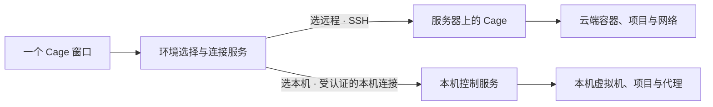

# 同一个 Cage 中的本机与远程环境

桌面产品只提供一个 Cage 图标、一套工作台和一条更新路径。远程工作台顶部显示所连接的主机。工作台从左侧栏的「SSH」打开主机列表。从只用云端的电脑打开 Cage，应当可以直接连接服务器，本机虚拟机无需启动。

完整桌面应用默认打开本机工作台，由本机控制服务提供账户和首页。macOS 上已验证连接真实 SSH、释放空闲本机后台和重新进入本机的流程。运行中环境的停止确认、任务状态变化与取消在隔离用例中验证。

## 打开与切换

首次打开直接进入原有本机账户页或本机工作台。打开首页只连接本机控制服务。已停止的虚拟机要等用户点击「启动 Cage 环境」才启动。即使虚拟机一直处于停止状态，用户仍可从侧栏「SSH」添加主机并进入远程工作台。主动断开远程时留在 SSH 主机列表。

进入工作台后，点击侧栏「SSH」，左侧项目栏在原位换为主机列表，右侧仍显示当前工作。用加号新建主机配置，选择已保存的主机后可连接、编辑或移除，返回箭头切回项目栏。本机仍运行时，验证目标成功后弹出确认卡片，显示已知的活动终端或正在执行的操作。提交选择后，终端、项目和浏览器随当前环境切换。远程主机缺少 Cage 服务时，在该主机下显示部署入口或说明。已有部署直接连接。服务器条件见[部署说明](../../deploy/cloud/README.md)。

| 用户操作 | 本机如何处理 |
| --- | --- |
| 从已停止的本机环境切到远程 | 先验证远端可用。本入口启动的控制服务确认空闲且可以退出后，关闭其监测、代理和进程，进入远程工作台。独立启动的服务沿用自己的生命周期。 |
| 连接另一台远程主机时，本机仍在运行 | 远端可用后，在当前页展示本机正在运行的环境、已知任务及终端，提供「停止本机并切换」「保留本机运行并切换」「取消」。停止会结束运行中的程序，用户可以返回保存工作。 |
| 保留本机任务，稍后想释放内存 | 窗口持续显示「本机也在运行」，可回到本机继续原终端，也可从这里明确停止本机。只有本机控制服务确认停止并退出后，才显示已释放。 |
| 远程断线，或从远程切回本机 | 断线时显示原主机和「重新连接」，云端任务继续。用户明确选本机时才接入本机服务。退出 Cage 释放客户端的 SSH、画面和音频连接。 |

运行着的虚拟机本身就需要内存，即使当前没有打开终端，也要让用户决定是否停止。缺少可靠的运行状态时显示「本机状态待确认」。正进行安装、迁移或已有其他调用者占用环境时，由本机控制服务决定是否可以停止，并说明原因。窗口未观察到活动不能作为自动停止的依据。

## 谁负责释放内存

同一个应用包内分开两种进程职责。原生窗口和轻量连接服务随桌面使用，负责环境选择、SSH、原生文件操作和工作台接口转发。本机控制服务随本机工作负载运行，负责账户、虚拟机、终端、挂载、代理和网络检查。保留任务时也保留保护这些任务的网络控制。云端控制服务由服务器独立管理。

打开本机首页时虚拟机保持其原有运行状态。进入工作台后再加载所需界面模块，终端、画面解码和音频按视图开启，并在离开时释放连接与缓冲。原生窗口、系统 WebView、SSH 和正在显示的画面仍会占用本机内存。安装在磁盘上的程序和持久虚拟磁盘，与这些正在占用内存的进程分开管理。首次选本机再检查 Linux 的虚拟化依赖、Windows 的虚拟化能力和 macOS 的本机运行组件。离开本机不卸载组件或删除磁盘。

本机控制服务可以复用现有的私有控制记录、令牌和进程身份检查。连接服务必须有独立的锁、控制记录、认证和退出路径。当前完整服务会启动监测，退出时还会关闭终端、共享和代理，直接用它兼任轻量入口会影响留下的本机任务。[服务初始化](../../internal/workbench/server.go) · [已有后台认证](../../internal/workbench/desktop.go) · [退出与资源回收](../../internal/workbench/lifecycle.go)

## 切换过程中保护工作

发起切换时，当前工作台仍拥有原环境。连接服务先验证目标的主机身份、协议和控制服务可达性，候选连接仅可执行握手。验证失败或用户取消就关闭候选连接，原工作台继续使用。云端 Cage 账户的解锁仍属于目标环境。

选择停止本机后，先冻结旧窗口的新业务操作，由原控制服务在操作锁内复核环境身份和任务，执行停止并核对该次作业结果。接着核实该配置的虚拟机、代理与本机控制服务已退出，再切换工作台。停止失败就显示本机实际状态和恢复操作。若本机已成功停止而远程随后断线，显示「本机已停止」和远端重连入口，避免把已完成的停止伪装成一次完整回滚。选择保留时只关闭旧窗口的显示连接，并按现有账户离开规则清理解锁材料，保留本机任务所属的控制服务。

每次成功进入本机或远程都生成新的连接标识。工作台重新绑定终端、下载、上传和输入事件，旧标识的请求失效。特别是从本机切到远程再切回本机，先前文件选择器的回调仍应失效。在远程工作台选择「停止本机环境」须使用明确指向本机配置的管理操作，按本机账户规则授权。本机账户锁定时，卡片提供「返回本机解锁」，取消尚未提交的连接并进入本机。随后用本机控制服务的作业结果更新提示，云端任务继续。

首版每份配置一个活动工作台，再次打开同一配置聚焦已有窗口。三平台均区分窗口隐藏与应用退出。隐藏窗口释放无订阅的画面、音频与解码资源。应用正常退出或窗口进程异常终止时，轻量连接服务关闭 SSH、监听器及附属日志进程后退出。

## 已有用户与验收

沿用 Cage 的应用身份和原本机配置路径，原账户、快捷登录、项目和虚拟磁盘继续由本机控制服务管理。主机列表、上次选择和远程文件的本机保存记录归入口管理。兼容已有完整应用与独立开发客户端的两处记录时，保留主机 UUID、SSH 指纹和云端实例标识。同一主机标识有冲突时，两份记录都列出；来自旧独立入口的冲突项分配新标识，首次连接重新核对指纹。显式指定的配置路径继续限定各自的数据范围。原生快捷登录按环境类型核对账户绑定，单独校验本次连接标识。更新面向同一个桌面应用，当前选中的服务器不会接收桌面更新的停止命令。

实际验收需在 macOS、Windows、Linux 用隔离配置跑四条路径。

1. 本机环境原本已停止。从打开 Cage 到远程编辑文件，再断线重连，记录进程启动事件。确认本机虚拟机全程保持停止，切到远程后释放入口启动的空闲本机控制服务。
2. 本机终端持续写入时切到远程。取消、远程握手失败和「保留运行」都应能回到同一个继续写入的终端。选择「停止并切换」后核对本机进程退出、磁盘和已保存文件保留，云端任务照常运行。
3. 同一窗口走本机 → 远程 → 本机，验证先前延迟的文件操作被拒绝。在远程工作台停止本机后，验证云端终端中的任务继续运行。正常退出和窗口进程异常终止后，只应留下用户明确保留的本机工作负载及其控制服务。
4. 在相同窗口大小、标签数和静置时间下，记录本机首页、远程工作台、本机运行、释放后远程工作台的进程树、内存和空闲 CPU。将窗口与 WebView、连接服务、虚拟化进程、代理分别列出，以各平台合适的内存指标对照。内存收益待实测后公布。
