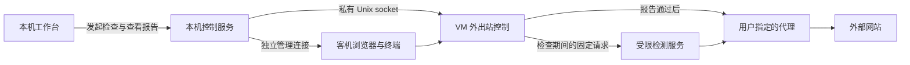

# 网络检查与出口规则

Cage 先启动可离线使用的环境，再检查网络与配置。关键项通过后才放行外网；IP 信誉和地区语言建议作为提示。检查失败时仍可使用共享文件、终端和客机本地网页。

## 用户可配置的规则

- 静态 IP：保存一个 IPv4 地址，检测请求的出口必须与之相同。
- 动态 IP：允许换地址，可限定同一城市、同一国家／地区，或不限制地区。城市同时比较国家、州／省和城市名称。
- 已保存的地址和地区不会被重检、重启或后台定位结果自动替换。首次未配置时可以采用检测结果；改动已有基准需要在设置中明确保存。
- 时区和语言可以在启动或应用设置时采用出口地区建议。运行中的环境不会因后台监测静默重启。语言采用内置地区默认值；多语言地区允许手动覆盖，未提供建议的地区保留已选语言。
- 位置查询失败后可点击“手动设置时区和语言”，关闭两个自动开关并编辑系统时区、系统语言与网页首选语言。使用静态 IP 或不限制地区时，手动模式在保存和启动时仅测量出口 IP，跳过位置查询；国家或城市限制仍需实际位置证据。切换手动模式不会修改出口规则。

地区约束依据 IP 数据库，属于近似定位。运行中约每 30 秒采样一次，发现越界或无法确认受限地区时暂停外网。通用 HTTP/SOCKS5 协议不能约束代理运营方每条连接使用哪个出口，因此 Cage 的规则是**检查采样并在发现异常后阻断**；上游的静态出口、会话粘性和地区路由仍需由代理本身保证。

## 检查和执行的位置

VM 外出站控制由 hostagent 持有。新实例默认关闭外网，guest 内的 sudo、网页和命令行均不能修改放行状态。控制接口不监听 TCP，凭据保存在未共享的宿主目录中。

检查期间仅提供 `198.18.0.254:80` 的内部检测服务。它终止客机请求，只允许固定路径，另行构造指定的 HTTPS 出口查询或 DNS 查询。URL、查询参数、请求体和客机请求头均不转发；每轮限制外部探测次数。其他公网 TCP 和公共 DNS 请求继续被拒绝。

当前版本的客机公网出站仅支持经代理的 IPv4 TCP。公网 IPv6、UDP 与 ICMP 被拒绝；DNS 使用同一代理转发到配置的 DoH 服务。SSH、显示与共享文件的内部管理连接独立保留。

初次构建基础镜像是明确的引导阶段：基础构建 VM 没有项目挂载，通过指定代理安装开发工具。此例外不适用于项目 VM。

## 什么证据可以放行

报告绑定配置指纹、本次 VM 运行标识和本轮检查标识。必须包含出站策略、终端检测通道、DNS、系统配置、浏览器配置、共享文件、管理接口、故障关闭、UDP、IPv6 和出口规则的证据。必需项目缺失、ID 重复、关键结果未知和检查会话已撤销时，都不能授权联网；额外的提示项不替代必需项目。

不同检查的证据范围明确区分：

- 运行时策略检查确认当前加载的地址族、协议和私网访问规则。
- 客机探针尝试访问公网及宿主管理端口，并与 VM 外网络层的拒绝记录核对。UDP 超时本身不作为通过依据。
- 共享文件使用临时文件完成双向往返；宿主私有目录使用无敏感内容的探针验证不可读，同时检查挂载范围。
- 浏览器通过隐藏、临时的诊断页面读回 Chromium 的时区、语言和平台，避免读取账号页面或改变可见标签的焦点。检测完成或失败后，先等待隐藏页面关闭，再销毁其临时浏览环境；页面关闭失败时保留该环境并从用户标签中排除，避免销毁仍被引用的环境导致整个浏览器崩溃。
- 故障演练只在检测专用连接中注入代理不可用，验证终端、浏览器和 DNS 的失败路径，不停止用户的代理进程。

这些证据支持列明的采样和策略结论，不能代替完整虚拟化逃逸审计，也不能判定账号资格或预测封禁。

## 运行中如何收回授权

放行授权有效 90 秒，由本机控制服务在非破坏性监测通过后续期。监测检查出口规则以及系统和浏览器的配置读回。控制服务失联时授权自动到期；关闭外网时会取消进行中的连接建立并关闭已有连接，包括 DNS 连接池所持的连接。

全面检查报告最多有效 24 小时。配置变化、VM 重启和新一轮检查会使旧授权失效；检测过程中产生的旧报告不能重新打开已经关闭的网络。后台监测不自行重复故障演练。

临时观察失败、代理探测失败或授权续期失败后，环境先保持离线，再由独立恢复任务重新执行完整检查；全部关键项通过后恢复联网。失败采用最长五分钟的退避，已知内存压力持续时延后重检。恢复绑定当前 VM、配置、授权代次和人工暂停序号，手动暂停、停止或新检查会使旧请求作废；已确认的配置不匹配不会作为临时故障恢复。见[计算资源与压力恢复](resources.md)。

暂停不进入普通任务队列，会立即取消检查和后台监测，再关闭出站。放行和续期与暂停串行核对，已撤销的检查不能重新放行。停止环境可取消正在启动或检查的任务；被取消任务的完成消息不会覆盖停止结果。工作台为启动任务记录私有停止标记，分离运行的 hostagent 在初始化前及运行中读取该标记，避免取消后的后台启动继续拉起 VM。标记绑定单个任务，不影响下一次启动。

人工暂停意图和暂停序号保存在私有 `network-intent.json`，控制服务启动监测前恢复；后台重启、订阅定期刷新和网卡恢复不会解除暂停。记录缺失时无法判断旧配置的暂停意图，因此默认关闭，等待用户明确恢复；损坏或无法读取时同样保持关闭并提示原因。启动、重检、恢复或应用环境配置，以及手动应用代理配置，可请求恢复；恢复必须先成功保存，且不能覆盖请求提交之后发生的暂停。暂停保存失败仍会撤销当前放行并报错，恢复保存失败也保持关闭。

## 外部服务与隐私

固定出口查询使用 [ipify 的公开接口](https://www.ipify.org/)。地区信息优先查询 [ipwho.is](https://ipwhois.io/documentation)，连接失败、超时、限流或位置无效时改查 [IP.SB](https://ip.sb/api/)。每个服务的请求最多等待 8 秒，取消检查会停止后续查询。两项位置查询都通过选定代理，携带已经测得的出口 IP；返回 IP 必须与之相同，国家代码和 IANA 时区必须有效。备用服务不会改变出口规则、时区或语言的保存基准。

同一 IP 的位置缓存一小时，最多保存 64 条，以减少查询和配额占用。各服务的免费额度和可用性由服务商决定；所有服务均失败时，报告会区分已取得出口 IP 与位置查询失败，受国家或城市约束的网络继续保持关闭。用户可关闭自动时区和自动语言并手动选择；手动时区、语言不能替代出口地区的检测证据。

社区检测网站仅在用户点击时从 Cage 浏览器打开，不自动抓取内部接口或上传完整报告。来源、许可及可采用的方法见[社区工具核查](../research/community-safety-tools.md)。分享报告会去掉配置指纹、运行标识、代理凭据、IP 地址和本机路径，不能用于放行环境。
