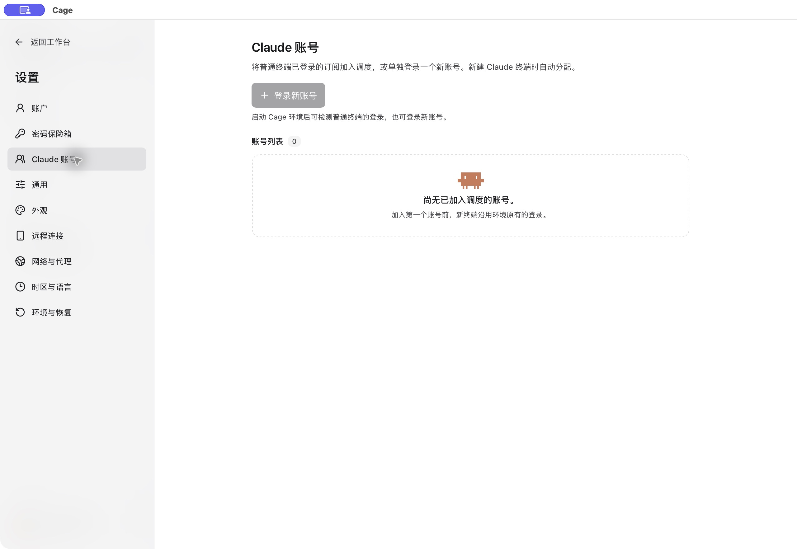

## 先区分三类账户

| 账户或登录 | 用途与归属 |
| --- | --- |
| Cage 账户 | 解锁当前主机的 Cage 工作台。 |
| Claude Code 账号 | 授权环境内终端使用 Claude 订阅，由“设置 → Claude 账号”管理与调度。 |
| 网页与 Claude Desktop 登录 | 各自保存登录状态，不会自动加入 Claude Code 调度。 |

先启动环境，等待工具就绪，再打开账号面板。账号功能以所用构建为准；没有该面板时先核对版本。

<figure class="guide-shot">
  
  <figcaption>Claude 账号面板：环境未启动、尚未登记账号。截图版本：0.1.6-alpha-preview（开发构建） · macOS 原生应用 · 2026-11-07。<a href="../../www/public/docs/screenshots/claude-accounts.jpg" target="_blank" rel="noopener">查看原图（2560 × 1764） ↗</a></figcaption>
</figure>

## 将已有登录加入调度

在 Cage 普通终端运行 `claude auth login`。如果终端显示 Claude 官方授权链接，点击它即可在 Cage 浏览器的临时标签中继续。按页面提示完成后，回到原终端确认登录结果。

登录成功后，账号面板会显示默认终端检测到的邮箱。核对后点“加入调度”。它只读取 Cage 环境里的登录，不读取主机系统终端上的账号。

如果普通终端原先是 A，后来登录成 B，Cage 会停止将默认目录分配给 A。B 需要单独加入。要让 A、B 长期共存，保留一份默认登录，另一个账号通过独立登录添加。

## 添加另一个订阅

1. 在“设置 → Claude 账号”点“登录新账号”。
2. 按打开的登录终端和临时授权浏览器提示完成官方登录。每个独立登录使用自己的配置目录。
3. 成功后账号按邮箱登记，可编辑备注，检查“参与自动分配”是否开启。
4. 点击项目旁的终端图标，新建 Claude 终端，查看标签所显示的分配账号。

取消登录不会增加可调度账号。同一订阅不会重复参与调度。独立账号需要重新登录时，先关闭仍使用它的终端，再按面板提示处理。

## 自动分配什么时候发生

自动分配发生在新建 Claude 终端时。在“调度设置”中选择：

- **均衡分配**：考虑正在使用的终端数量和已知剩余额度，条件相近时轮转，并兼顾同一项目近期使用的账号。
- **按列表顺序优先**：优先使用排在前面的可用账号，相关额度已耗尽、登录失效或暂停分配时使用后面的账号。通过“上移”调整顺序。

关闭某个账号的“参与自动分配”，只影响以后新建的终端，正在使用该账号的任务可以继续。改变调度模式不改变已有会话的账号绑定。

## 共享技能、指令和记忆

登录凭据各自独立，Cage 会话列表统一展示历史。项目文件、项目中的指令与技能直接共用；用户级的本地技能、指令、规则和代理定义共用环境内的资料，同一个项目的自动记忆使用同一位置。更换账号后可以继续使用这些资料。主机系统的个人配置不会自动导入。

从 Claude.ai 账号或组织下载的技能仍属于原账号；登录身份、凭据、账号远程设置和 MCP 的账号授权不自动合并。原有资料同名且内容不同时，Cage 保留原文件并提示先核对，避免覆盖用户资料。

## 在同一会话中换账号

先在账号卡片中填写“接续分组”，将允许接收同一份会话历史的账号设为同一组。未分组的账号不进行跨账号接续。工作资料与个人资料不应随意混入同一组；分组控制自动交接的目标，不构成文件系统安全隔离。

电脑终端上方和手机会话中的账号按钮显示当前绑定。展开后可以选择：

- **每次询问**：由用户选择目标账号，勾选允许交接历史，再执行“切换并恢复历史”。
- **额度耗尽后自动接续**：官方 CLI 报告限流且额度读数确认窗口耗尽时，尝试在同组可用账号间接续。
- **始终等待原账号**：自动接续保持关闭，仍可手动发起一次明确确认的切换。

账号设置中的授权默认只影响新会话；会话内可以单独修改。接续保留同一个 Cage 会话入口，目标账号运行新的官方 CLI 进程并恢复历史，原历史保留。手动切换默认只恢复历史；需要继续执行时，勾选“恢复后继续未完成的任务”。跨账号的服务端提示缓存可能重建，第一轮可能更慢。

交接前必须停止原执行者。执行中的工具、未处理消息、工具审批、后台任务或结果不明的工具会阻止切换；按提示结束或核对后重试。交接失败时可以重试原操作，准备阶段也可取消并保留原账号。Cage 不会为恢复重新提交旧消息或已完成的工具，但模型后续仍可能决定再次调用工具，需要继续检查任务结果。

这套能力运行客机中的原版 Claude Code，不提取订阅令牌代理模型请求。当前代码已接入 Linux、macOS 和 Windows 客机路径；原生客机须使用匹配的环境组件，Windows 还需登录并解锁绑定的客机桌面。

跨账号恢复、共享资料和授权检查已通过隔离官方 CLI 验证，测试使用合成账号与本地模型响应。真实双订阅服务端兼容性、原生客机完整登录与交接，以及供应商对自动轮换的具体许可仍须核实。CLI 版本或组织策略不支持 Channels 时，手机接续能力也会受到限制。旧额度、服务过载或未知错误不会被当作已确认的额度耗尽。

## 查看五小时和七天额度

打开面板会向环境内的官方 Claude Code 查询五小时、七天用量与重置时间。卡片的“检查状态”可以立即刷新，无需先发一条模型消息。

某个额度窗口没有返回读数时，界面会说明结果，并保留该窗口上次的百分比和读取时间。旧读数不能视为实时可用额度，也不能代表服务一定接受下一条请求。

## 无账号可分配时

按以下顺序检查：账号是否成功登录、是否开启参与分配、是否已达到已知额度、预计重置时间是否已到。先点“检查状态”，身份失效时按提示重新登录。

普通终端切换过账号时，检查新身份是否单独加入调度。官方授权或请求失败，继续查[Claude 登录与账号异常](troubleshooting.md#claude-登录与账号异常)。
