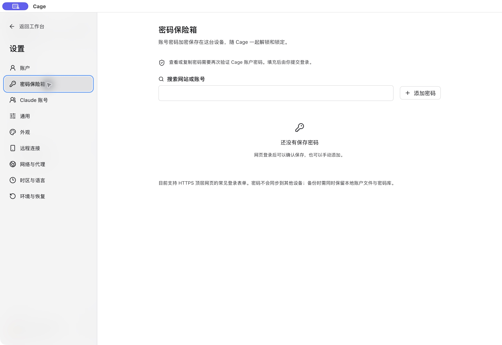

## 打开网页与浏览器设置

点击侧栏“浏览器”，用地址栏访问网站，顶部加号新建页面。`claude.ai` 入口直接打开 Claude 官网。`localhost` 属于当前 Cage 客机，预览服务需从 Cage 终端启动。

地址栏右侧的浏览器菜单提供设置、无痕和网站数据等操作。浏览器设置页可搜索“新标签页、外观、隐私与网站数据、扩展、关于浏览器”。新标签默认地址影响之后的新建标签；横排或竖排标签布局立即生效，保存在当前客户端。

关闭浏览器视图只返回原工作区，页面和登录继续保留。需结束无痕会话时，关闭全部无痕标签或停止环境。

Linux 环境在最后一个浏览器查看窗口离开后，将浏览器窗口最小化，让后台网页采用 Chromium 的节流机制。返回浏览器时恢复原窗口和未保存的输入。多个工作台同时查看时，仍在查看的窗口继续显示。手机浏览器拥有独立会话。

Linux 环境的浏览器和 Claude Desktop 画面按使用情况调整刷新率。操作键盘、鼠标或调整窗口时保持 60 Hz；停止操作约 3 秒后降到 30 Hz，约 3 分钟无操作后降到 20 Hz，再次操作时立即恢复。分辨率、字号和清晰度保持不变，网页动画与视频在无人操作时按较低帧率播放。此功能随环境组件更新启用，需要环境中的 `python3-xlib`：已安装 Claude Desktop 的环境直接生效，只使用浏览器的旧环境在下次更新环境工具后生效。

新配置默认开启“设置 → 通用 → 优先流畅”。Linux 浏览器和 Claude Desktop 使用 1.5 倍渲染，字号与可见内容尺寸保持一致，比 2 倍渲染减少约 44% 的像素量。需要更清晰的细节时可关闭，画质设置在下次启动环境时生效。已有配置沿用原画质。

地址栏右侧的下载按钮在右上角展开文件列表，可查看下载进度、另存为、打开文件或在文件夹中显示；保存失败时可重试。长列表在面板内滚动，点击外部或按 Esc 收起。侧栏“下载”也可打开此面板。

浏览器设置的“隐私与网站数据”还提供“网站权限”和“清除浏览数据”，打开 Chromium 对应页面。摄像头、麦克风等权限应结合环境实际设备能力判断。“关于浏览器”中的“搜索引擎”和“下载设置”可以打开更多原生浏览器配置；网页显示这些选项不代表 Cage 已接通所有设备能力。

## 收藏与标签管理

地址栏星标或 Mac 的 `⌘D` 可收藏当前页，修改名称并选择或新建收藏夹。收藏夹按钮或 `⌘⇧O` 打开管理，可搜索、打开、改名和移动收藏。Windows/Linux 对应使用 Ctrl。

删除收藏夹会将网页移至“未分类”。收藏属于当前 Cage 配置，所有项目共用，不随切换项目消失。

标签右键或 Shift+F10 可打开操作菜单，拖动改变顺序。列表较多时可搜索已打开网页；置顶标签在自己的分组内排序。

## 使用无痕会话

在菜单选“新建无痕标签”，或按 Mac 的 `⌘⇧N`、Windows/Linux 的 `Ctrl+Shift+N`。无痕标签和地址栏会明确标记。无痕页面的加号继续新建无痕标签，需要普通页时从菜单选择。

普通和无痕会话的 Cookie、登录与网站存储分开；同一批无痕标签共用临时会话。关闭最后一个无痕页会清理会话，重启不会恢复这些标签。无痕不会提示保存密码；主动保存的收藏和下载仍保留。

无痕会话继续使用相同代理出口，网站和代理服务仍能观察请求。隐藏窗口不会结束后台无痕进程。

## 查看与清理 Cookie

从浏览器菜单进入“管理 Cookie”，查看当前网站或所有网站，按网站或名称搜索，可查看值、删单条、清空当前网站或当前会话的全部 Cookie。

清理仅影响当前标签所属的普通或无痕会话。**搜索条件不会缩小清空范围**，确认前核对网站与会话，清理后可能需要重新登录。Cookie 清理不会同时删除网站的 localStorage。

清空普通会话全部 Cookie 也会清除文件编辑器认证，使用编辑器菜单的“恢复编辑器”重新进入。

## 安装或导入扩展

在浏览器设置的“扩展”中导入 Manifest V3 ZIP，单包上限 32 MB。安装前阅读界面列出的权限，再确认。仅安装可信来源，扩展可能读取它获准访问的网页内容。

桌面版可从本机 Edge、Chrome、Brave 或 Chromium 复制扩展及启停状态。导入不会复制浏览器账户、Cookie 或扩展自身的登录数据，部分标识变化的扩展需要重新配置。扩展在 Cage 浏览器中运行，本机浏览器的操作环境与网络不会因此迁移。

旧环境缺少入口或安装组件报错时，先更新应用与环境组件，再重新打开浏览器。

<figure class="guide-shot">
  
  <figcaption>密码保险箱的管理入口。截图版本：0.1.6-alpha-preview（开发构建） · macOS 原生应用 · 2026-11-07。<a href="../../www/public/docs/screenshots/password-vault.jpg" target="_blank" rel="noopener">查看原图（2560 × 1764） ↗</a></figcaption>
</figure>

## 保存网站密码

网页登录完成后，在工具区选择“保存密码”或“更新密码”。再次访问时展开“密码”，选账号填入，最后由你提交登录。

“设置 → 密码保险箱”支持搜索、手动添加、修改、删除和恢复网站提示。查看或复制密码需再次输入 Cage 密码。支持范围与备份要求见[设置参考](settings.md#密码保险箱)。
