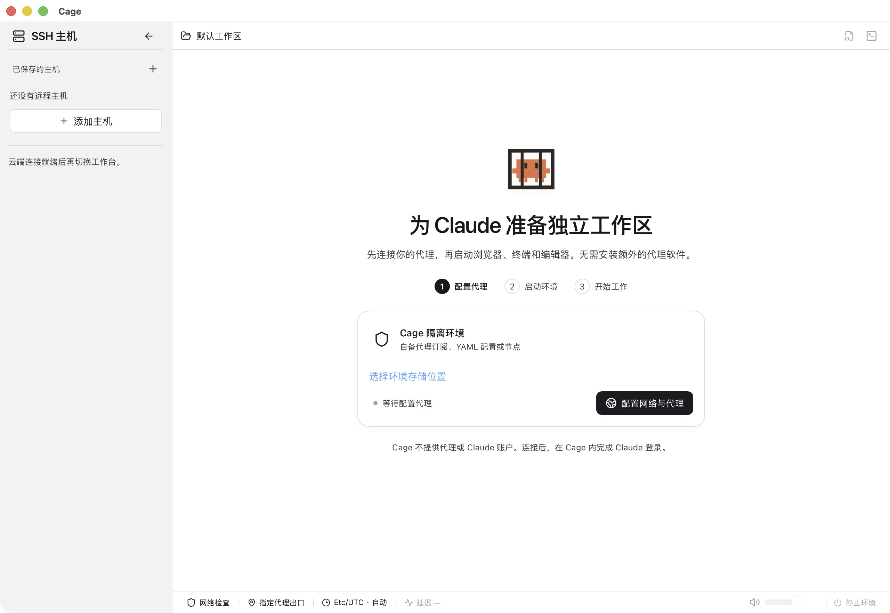
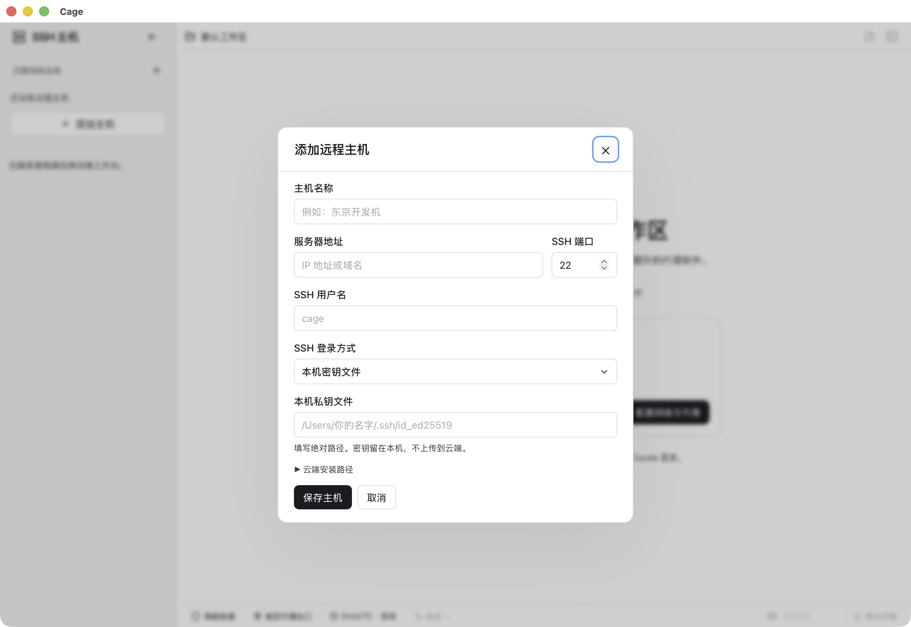
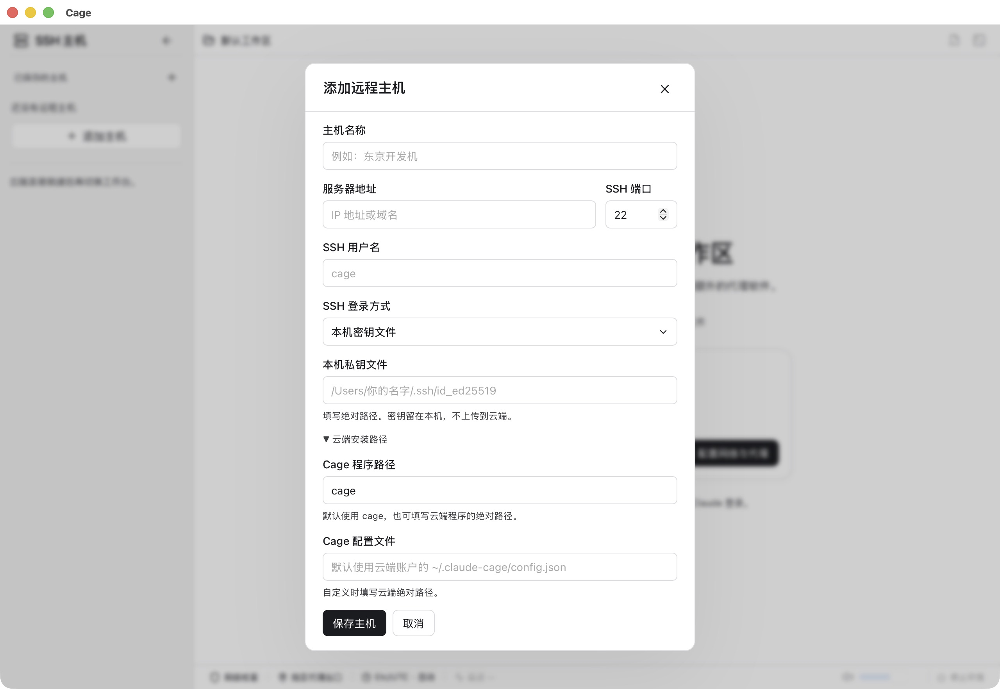

## 什么时候选择云端

希望任务在服务器上持续运行，或本机不适合运行虚拟机时，可以使用云端模式。终端、浏览器、编辑器、Claude Desktop 和网络出口位于服务器，电脑显示同一套工作台。本机虚拟机可以保持关闭。

服务器模式通过 rootless 容器运行，不需要 KVM。它仍需要满足系统、权限和资源条件，并非所有 VPS 都可以直接部署。

## 准备服务器

当前目标为 Linux x86_64，具备 systemd 用户服务、cgroup v2、rootless 用户命名空间、至少 65,536 个 subordinate UID/GID，以及 `/dev/fuse`、`/dev/net/tun`。普通 SSH 用户需要相应权限；还需 OpenSSH、curl、tar、sha256sum、iproute2 与 iptables 等基础工具。

完整前提和维护命令见[部署说明](https://github.com/tan396222-prog/Claude-AntiBan/blob/main/deploy/cloud/README.md)。权限缺失应修复服务器配置，不要改用特权容器或把 Docker socket 暴露给工作环境。

无人登录时常驻需要服务器管理员核对 systemd 用户服务与 linger；无人登录、宿主重启恢复及不同原生客户端的验收需要分别完成，单次连接成功不能保证这些场景。

<figure class="guide-shot">
  
  <figcaption>SSH 主机侧栏：添加自己的服务器。截图版本：0.1.6-alpha-preview（开发构建） · macOS 原生应用 · 2026-11-07。<a href="../../www/public/docs/screenshots/ssh-sidebar.jpg" target="_blank" rel="noopener">查看原图（2560 × 1764） ↗</a></figcaption>
</figure>

## 从侧栏部署并连接

1. 打开 Cage，进入左栏“SSH 主机”，点击加号填写名称、地址、端口、用户名和本机密钥文件或 SSH agent。自定义路径可在“云端安装路径”设置。
2. 点击“连接此主机”，将 SSH 主机指纹与服务器独立显示的记录核对。指纹变化时先核查原因，再继续。
3. 首次使用空配置目录时，点击“部署并连接”。Cage 传输匹配的程序和脚本，在服务器准备独立引擎与持久环境。
4. 已部署且就绪时直接进入；能确认归属的用户服务已停止时会尝试启动。安装中断后可用同一版本重试。
5. 云端工作台打开后，创建或解锁服务器自己的 Cage 账户，再配置服务器的代理和项目。

本机有任务时，连接卡片提供保留或停止本机环境的选项，停止前先保存内容。不要在未经备份的已有本机数据目录上首次部署云端实例。

<figure class="guide-shot">
  
  <figcaption>远程主机地址、认证与私钥路径表单。截图版本：0.1.6-alpha-preview（开发构建） · macOS 原生应用 · 2026-11-07。<a href="../../www/public/docs/screenshots/ssh-host-form.jpg" target="_blank" rel="noopener">查看原图（2560 × 1764） ↗</a></figcaption>
</figure>

## 服务器项目与本机共享

远端工作台可选择服务器目录。云端账户、浏览资料、保险箱、节点与系统语言属于该服务器，本机已有配置不会自动复制过去。操作前看清当前主机名称。

需要使用本机源码时，按界面授权一个具体项目，选择所需的只读或读写方式。共享仅在授权连接期间有效。目录权限、Git 保护和元数据限制仍生效；读写共享意味着云端可直接修改本机源文件，先备份并审查改动。

上传由本机选择器读取你选定的文件，下载由服务器提供文件内容，再明确保存到本机。远端文件与本地副本的保存位置分别显示。

## 断开、锁定与停止

关闭本地窗口或断开 SSH 会释放客户端连接，服务器环境和任务继续运行。重新连接读取仍存活的会话。需要结束远端任务时，在对应云端工作台明确“停止环境”。

切换主机后，旧连接的文件选择、输入和请求不能继续进入新主机。连接失败时不会自动改为操作本机。对发送、保存等结果不明确的操作，重连后先核对状态再重试。

<figure class="guide-shot">
  
  <figcaption>自定义服务器上的程序与配置路径。截图版本：0.1.6-alpha-preview（开发构建） · macOS 原生应用 · 2026-11-07。<a href="../../www/public/docs/screenshots/ssh-install-paths.jpg" target="_blank" rel="noopener">查看原图（2560 × 1764） ↗</a></figcaption>
</figure>

## 更新与故障恢复

客户端更新只更新本机程序，服务器维护另行执行。更新服务器前保存任务、停止相关环境与服务，完整保留配置、项目、容器文件系统及引擎数据，用原绝对路径恢复。

不要删除容器或执行清理全部引擎数据的命令来升级；容器可写文件系统也保存持久资料。出现连接、指纹或部署前提错误时，查[SSH 与云端故障](troubleshooting.md#ssh-或云端部署失败)。
