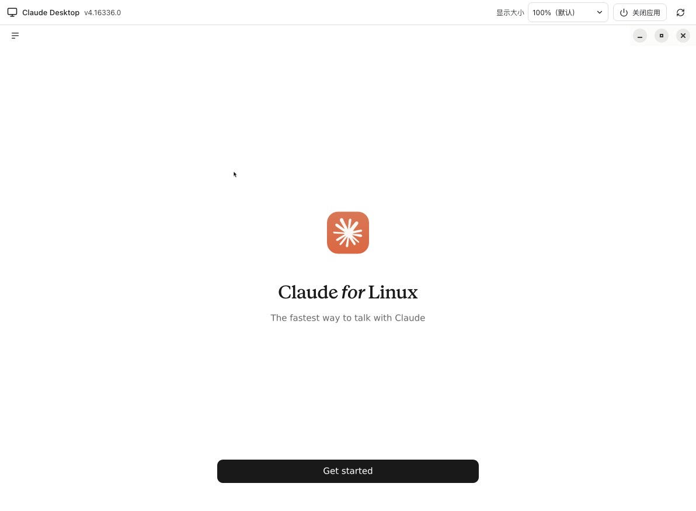

## 安装与登录

在侧栏点击“Claude Desktop”，首次选择“下载并安装”。先启动环境并确认代理可用，Cage 从 Anthropic 官方源安装；下载失败可查看进度并重试。安装维护下载可在业务外网尚未放行时进行，应用内联网仍需要关键检查通过。

首次登录在 Cage 内完成，不导入主机上的 Desktop 账号。登录和外部网页会在 Cage 浏览器打开，回调完成后返回 Desktop。若仍停留在浏览器，可回到侧栏应用入口查看。

Chat 和 Code 在同一个官方应用内使用。需要额外虚拟机的 Cowork 暂未适配；当前手机远程会话也不控制 Desktop 窗口。

<figure class="guide-shot">
  
  <figcaption>云端 Linux 环境中的 Claude Desktop 欢迎页。截图版本：Claude Desktop 4.16336.0 · 真实 Linux 云端环境 · 2026-11-06 · Cage 版本未记录；未登录 Claude。<a href="../../www/public/docs/screenshots/cloud-desktop-welcome.png" target="_blank" rel="noopener">查看原图（1192 × 875） ↗</a></figcaption>
</figure>

## 调整文字与画面

右上角“显示大小”默认 100%，调小可显示更多内容，调大可放大文字和控件。窗口、侧栏变化时画面自动适配；设置保存在本机。提示“画面尺寸未能同步”时点“重试调整”。

滚动卡顿时到“设置 → 通用”开启“流畅画质”，保存并在下次启动环境后生效。它降低绘图像素密度，控件逻辑大小保留。性能还受主机 CPU、内存以及远程网络影响。

## 选择项目与传文件

Desktop Code 请求选择目录时，Cage 显示“选择工作项目”。选择已授权项目并点“使用此项目”，或用“添加本机项目…”明确新增目录。项目改动会直接作用于共享原件。

网页或 Desktop 上传附件时，点“选择本机文件”调用系统窗口。也可将文件拖入支持附件的区域，或在选中附件输入位置后粘贴。详细数量、大小及保留规则见[上传与附件](workbench.md#上传下载与附件)。

本机模式下，从 Desktop 打开已保存的项目文件或“在文件夹中显示”，会交给本机默认应用或文件管理器。文件必须属于 Cage 已授权项目。云端文件需要按远端下载流程保存到本机。

## 关闭、更新与恢复

切换到终端或浏览器时 Desktop 保持运行。应用上方的“关闭应用”释放其运行资源，登录资料继续保留；关闭后可选“更新 / 修复安装”。

Cage 为内部系统密钥环创建和解锁所需凭据，不必再设一份密钥环密码。修改 Cage 密码会保留 Desktop 登录数据。

更新 Cage 或环境组件后，先保存工作、关闭并重新打开 Desktop，让文件选择、缩放及其他组件生效。画面或上传仍异常时，查[故障排查](troubleshooting.md#浏览器desktop-或文件上传异常)。
