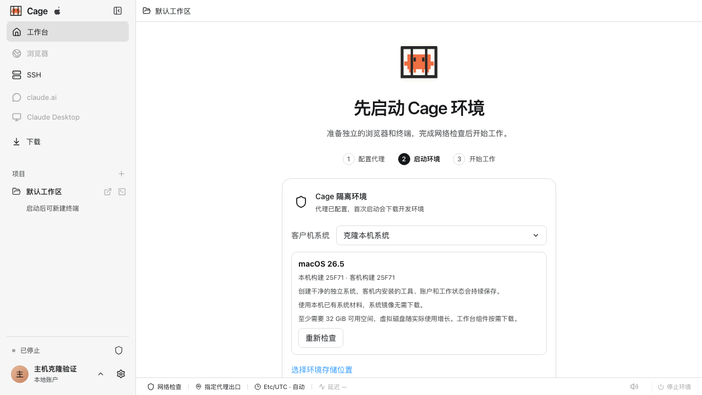
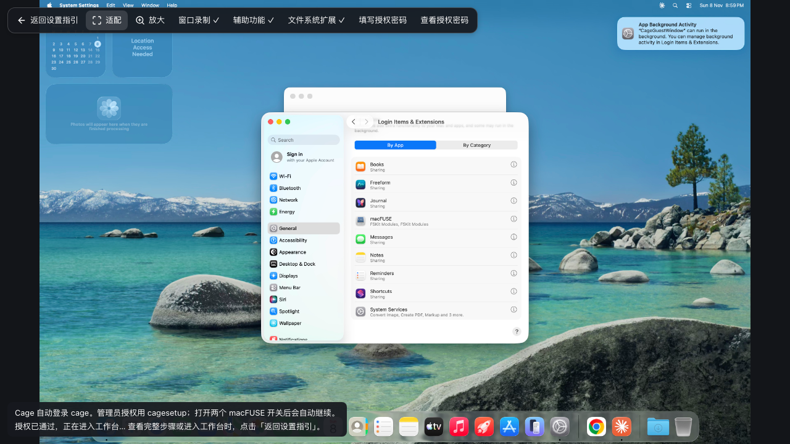

## 在熟悉的系统里开发

开发 Mac 应用时，需要 macOS 的工具链；处理 Windows 项目时，也希望使用 PowerShell 和 Windows 程序。Cage 让这些工具运行在独立的虚拟机中，同时把终端、浏览器、编辑器和官方 Claude Desktop 放在同一个工作台里。你可以继续使用熟悉的系统，按项目需要共享文件，并独立管理工作环境的网络。

运行 Cage 的电脑称为主机，虚拟机里的系统称为客机。两者可以属于同一种系统，具体版本可以不同。例如，Mac 主机可以运行 Apple 为这台设备提供的兼容 macOS 客机，无需与主机版本完全一致。

## 这台电脑可以选择什么

| 你的电脑 | 可选客机 | 适合的工作 |
| --- | --- | --- |
| Apple Silicon Mac，macOS 14+ | macOS、Debian 13 或 Ubuntu 22.04，均为 ARM64 | macOS 原生开发、Mac 版 Claude Desktop，或 Linux 工具与服务。macOS 客机版本需与硬件和主机兼容。 |
| Windows 11 x64 专业版、企业版或教育版，具备完整 Hyper-V | Windows 11、Debian 13 或 Ubuntu 22.04，均为 x86_64 | PowerShell、Windows 原生编译与调试、Windows 版 Claude Desktop，或 Linux 开发。 |
| 其他受支持的 Windows 10 22H2 / 11 x64 主机 | Debian 13 或 Ubuntu 22.04 x86_64 | 在独立 Linux 环境中使用 Claude Code、浏览器与开发工具。需要 Windows 虚拟机监控程序平台。 |
| Debian 12/13、Ubuntu 22.04/24.04 x86_64 主机 | Debian 13、Ubuntu 22.04，或与本机同发行版的 Linux | Linux 开发与服务。需要 KVM 和当前用户的访问权限。 |

选择与主机同类的系统，可以继续使用对应平台的应用、路径习惯和工具链。Debian 适合希望减少系统安装负担、主要使用命令行与 Linux 服务的用户；三个受支持的桌面平台都可以选择它。Intel Mac、Windows ARM64 和 Linux ARM64 暂不支持。

客机系统决定项目中的程序实际在哪里运行。需要额外虚拟机的应用功能还受嵌套虚拟化等条件限制，Claude Desktop 的 Cowork 暂不支持。

## 当前开发构建的验证范围

系统选择和平台接线不代表所有操作已完成实机验收。公开安装包包含的能力，以对应发行说明为准；下面用于核对当前开发构建。

| 路线 | 已验证 | 尚待验证 |
| --- | --- | --- |
| Mac 本机版本匹配 | 真实首次创建、系统恢复、权限确认、项目双向读写、编辑器及冷启动持久性 | 官方 Claude 在线登录与完整工作流程；本轮创建验证保持客机外网关闭 |
| Windows 本机版本匹配 | 官方材料下载与校验、自动建机、首次启动、冷启动和测试文件保留 | 修复后的最终工作台登记与完整首次使用 |
| Linux 同发行版匹配 | 镜像身份、安装来源和模板；Ubuntu 22.04 容器中的原生窗口、重装与卸载数据保留，以及真实浏览器启动 | 完整 KVM 首装、项目共享、物理桌面输入和官方 Claude 登录 |
| 独立 Ubuntu 22.04 | Mac ARM64 真实安装、冷启动、项目共享、终端、浏览器、编辑器、中文输入、音频、剪贴板、Desktop 安装及欢迎页、网络暂停与代理中断、原磁盘持久化 | Windows WHPX / Linux KVM 实机首装，官方 Claude 登录和业务会话 |

多账号、手机和原生 Desktop 文件操作还需各自的应用级检查，分别见[多账号与额度](accounts.md)、[手机连接](mobile.md)和[Claude Desktop](desktop.md)。

## 首次创建环境

1. 按[安装与首次启动](installation.md)安装适合主机的 Cage，创建或解锁 Cage 账户。
2. 在独立初始化界面的“系统与存储”中选择客机系统和存储位置。
3. 配置自己的代理。选择“自动匹配本机系统版本”时，Cage 检测主机版本，复用已有镜像或下载匹配的官方镜像。手动选择 macOS 时可使用已有官方 IPSW 或下载 Apple 兼容恢复镜像，Windows 使用 Microsoft 官方 ISO，Debian 由 Cage 下载匹配架构的基础镜像。
4. Cage 自动准备客机账户和开发组件。macOS 自动配置登录；系统要求的权限提示由你确认。Windows 的首次系统授权见下文。
5. 安装、必要授权和网络检查完成后，点击“进入工作台”，再打开项目、新建终端，并在 Cage 内完成 Claude 授权。以后启动复用原系统、工具、文件和登录资料。初始化中断后重新打开仍回到原流程。

同一主机平台使用一个 Cage 安装包，无需为不同客机另装一套 Cage。macOS 与 Windows 的系统介质从厂商获取，按各自许可使用；Cage 不附赠操作系统授权，也不会自动导入主机的系统账户、Claude 登录、浏览器资料或 SSH 密钥。

安装卡片会显示当前阶段。下载镜像时可查看已下载大小、总量、百分比和实时采样速度；校验镜像单独显示进度。系统恢复和安装工具期间，卡片显示正在处理的步骤；这些步骤没有可测总量时不显示百分比。中断后可点击“继续安装”，复用原安装记录和已保存的下载。

### 直接安装 Ubuntu 22.04

首次创建时，从“客户机系统”选择 **Ubuntu 22.04**。此选项独立于主机发行版：Mac 下载 ARM64 镜像，Windows 和 Linux x86_64 主机下载 amd64 镜像。无需提供 ISO 或输入镜像摘要，Cage 使用固定版本的 Canonical 官方云镜像并校验 SHA-256。

镜像约 669–697 MiB，创建前至少预留 17 GiB；虚拟磁盘按实际写入增长，后续项目和工具仍需额外空间。安装后使用同一工作台中的终端、Chrome for Testing、编辑器和按需安装的 Claude Desktop。

安装中断后继续使用原镜像、安装身份和磁盘。完成后普通启动仍为 Ubuntu；来源资料缺失或不一致时提示恢复原资料，不自动改用 Debian。已有环境不能通过这个选项直接覆盖或转换系统。当前开发构建的实机范围见本页上方的验证范围表，旧安装包仍以其发行说明为准。

### 自动匹配本机系统版本

首次创建时可选择“自动匹配本机系统版本”。Cage 检测本机系统版本，优先复用缓存或下载目录中的匹配镜像，缺少时自动从系统厂商下载，再安装到独立、可长期保存的客机中。主机的应用、个人文件和登录状态不会复制到客机。自动识别覆盖匹配 IPSW、同名官方 ESD 和 Linux 镜像，已有 Windows ISO 可在“Windows 11”选项中选择。

选择后会显示目标系统、本机与客机构建号、预计系统下载量和可用空间要求。macOS 匹配相同版本和构建号。Windows 匹配发行版本、版本类型和语言，官方介质的补丁号可以与本机不同，两个构建号会同时显示。Windows 使用压缩系统文件，Linux 使用对应发行版的最小云镜像，虚拟磁盘按实际写入增长。

<figure class="guide-shot">
  
  <figcaption>本机版本、安装材料与空间预览。截图版本：0.1.6-alpha-preview（开发构建） · macOS 原生应用 · 2026-11-09 · 独立首装验收；所示构建使用“克隆本机系统”名称，当前入口为“自动匹配本机系统版本”。<a href="../../www/public/docs/screenshots/host-system-clone.png" target="_blank" rel="noopener">查看原图（1280 × 720） ↗</a></figcaption>
</figure>

在 macOS 上使用此选项需要 Apple Silicon 和 macOS 26.4 或更新版本，当前工作台的文件系统扩展依赖该版本提供的只读挂载能力。Windows 需要 Windows 11 x64 和完整 Hyper-V。Linux 支持 Debian 12/13、Ubuntu 22.04/24.04 x86_64。

Ubuntu 22.04 主机选择“自动匹配本机系统版本”时，从官方校验过的云镜像创建全新的 Ubuntu 22.04 客机；不会复制主机的账户、文件或登录状态。Ubuntu 客机使用独立安装的 Chrome for Testing 和 noVNC，版本及摘要由 Cage 固定，浏览器保留沙箱、扩展和受控网络。

Windows 在确认系统提权后自动创建磁盘、安装系统和建立客机账户。macOS 恢复完成后继续进入 Cage 的首次权限引导。工作台组件按需获取，完整离线安装需要系统材料和开发组件均已在本机准备好。

下载中断时点击“继续安装”，程序复用原安装身份和已下载部分。找不到匹配版本时会说明缺少的材料，可选择已有官方镜像。创建过程及恢复材料缓存位于所选环境存储位置。

### Mac 的首次系统授权

先注册 Cage 用户名和密码，再选择 macOS 客机。Cage 用同一套账密创建客机普通账户，并加密保管安装凭据。用户名需以小写英文字母开头，使用 1–31 个小写字母、数字或下划线，不能使用系统保留名称；密码使用 8–256 个英文键盘可输入的字符。安装中断后点击「继续安装」复用原安装身份和凭据，原磁盘和文件保留。

在「设置 → 账户」修改共用密码时，会同步客机账户、登录钥匙串、首次授权密码和自动登录记录。客机关闭或同步中断时，Cage 保留待同步记录，下次启动继续处理；完成前客机可能仍需原密码，暂时不能再次改密。已有客机保留用户名与用户目录，设置共用账密时 Cage 使用该用户名。用户名用于客机后会固定。

安装完成后，Cage 自动启动和登录虚拟 Mac，跳过可选的首次设置页面，并显示需要确认的系统权限：

1. 在客机的「窗口录制」「辅助功能」设置里允许 Cage Guest Window；若系统要求「退出并重新打开」，按提示完成。Cage 自动定位下一项未完成的权限，也可点击同名按钮重新打开。
2. Cage 自动打开「文件系统扩展」面板，打开 `macFUSE` 和 `macFUSE (local)` 两个开关即可。若页面被关闭，点击 Cage 的「文件系统扩展」按钮直接重新打开。Cage 自动检查只读测试卷能否挂载和卸载，通过后继续进入工作台；只打开其中一项不能完成验证。

如果「安装与检查」页提示默认工作区需要授权，点击「查看并授权」，核对文件夹后，在客机对话框中点击 `Use Project`，让终端和编辑器使用这个目录。可以取消，也可以在请求过期后重新申请。

如果系统没有自动展开面板，可手动进入「General（通用）→ Login Items & Extensions（登录项与扩展）→ By Category（按类别）→ File System Extensions（文件系统扩展）」。如果进入「macFUSE Extensions」后开关点击无反应，点击 Done 返回，改用上述入口。macOS 的 By Application（按应用）入口存在开关无法启用的问题，见 [macFUSE 维护者说明](https://github.com/macfuse/macfuse/issues/1194)。

这些权限都在虚拟 Mac 内确认，首次设置期间客机断网。Apple 询问管理员身份时，用户名填 `cagesetup`，密码与 Cage 账户相同；也可点选密码框后使用「填写授权密码」。Cage 检查三项授权后自动完成设置并进入工作台；收尾失败时提供重试入口。

Cage 会撤销临时管理员并关闭这台客机的首次设置入口。以后启动自动登录；主动锁屏或注销时，从「登录客机账户」登录，必要时点击「查看客机密码」。FileVault 或其他系统设置阻止自动登录时，保留手动入口。账户、权限和文件随客机磁盘保留。客机系统自动登录使开机后账户直接可用，主机账户和 Cage 的解锁负责保护访问入口。

<figure class="guide-shot">
  
  <figcaption>Mac 客机首次权限引导与文件系统扩展设置，画面显示授权已通过。截图版本：0.1.6-alpha-preview（开发构建） · macOS 原生应用 · macOS 26.5 客机 · 2026-11-09 · 独立首装验收，未登录 Claude。<a href="../../www/public/docs/screenshots/macos-first-permissions.png" target="_blank" rel="noopener">查看原图（1280 × 720） ↗</a></figcaption>
</figure>

### Windows 的首次系统授权

安装 Windows 客机时，系统会询问是否允许 Cage 完成虚拟机设置和安装管理助手。确认这一系统提权提示后，日常打开 Cage 继续使用普通权限；助手只管理登记给当前用户的 Cage 客机，不把你加入具有全部虚拟机管理权的宿主组。取消授权会保留已有安装进度和磁盘，可以之后继续。

Windows 客机的系统账户和应用登录独立保存。管理助手未连接或原客机配置变化时，Cage 会提示核对原环境；恢复助手或更新 Cage 不应重建账户、替换原系统盘或初始化个人目录。

### 使用 Windows 本机 ISO

选择 Microsoft 官方 Windows 11 x64 ISO 后，在系统授权打开的安装窗口中设置客机初始本地管理员。默认名称为 `CageAdmin`，可以修改。请保存这个账户的密码，后续登录客机和继续安装时都需要使用。

Cage 将账户信息写入具有私有权限的安装应答盘，Windows 首次设置据此创建本地管理员并跳过联网账户引导。客机保持零常规 Hyper-V 网卡，完成组件置备后使用 Cage 网络通道。应答盘在确认客机已完成首次设置、可以通过管理员账户连接后清理。

1. 在“虚拟机连接”（VMConnect）窗口选择 Windows 版本、目标磁盘，确认许可并完成区域设置。本轮 PowerShell 创建窗口会自动关闭。
2. 使用安装前设置的本地管理员登录客机桌面，回到 Cage 点击“已进入桌面，继续安装”。
3. 确认系统授权，在 PowerShell 安装窗口再次输入客机管理员账户。保持该窗口开启，等待组件下载、安装和配置结束。Cage 会创建用于工作台的专用普通账户，并重启客机完成首次登录。
4. 回到 Cage 完成网络检查，再进入工作台。

已有客机继续使用原账户和系统盘。若安装由旧版本创建，使用当时创建的客机管理员继续。若仍停在 Windows 首次设置的强制联网页面，可以在 VMConnect 中按 `Shift+F10`，先检查 `%WINDIR%\System32\OOBE\BypassNRO.cmd` 是否存在。仅在该脚本存在时运行它，重启后选择离线继续并创建本地账户。各 Windows 构建提供的入口不同，缺少该脚本时应保留虚拟磁盘并记录 Windows 构建号，进一步核查该版本的离线设置方式。

安装卡片区分等待 Windows 首次设置、组件下载和组件配置。原用户注册助手失败时，操作详情会保留 `enrollment_pipe_listen_failed` 或 `enrollment_pipe_accept_failed` 及 Win32 错误码，便于定位继续安装的问题。

## 下载量与磁盘空间

系统镜像的下载大小和虚拟磁盘容量是两件事。Debian 基础镜像约 320–325 MiB，初始虚拟磁盘容量上限为 24 GiB；macOS 和 Windows 的安装介质与系统占用更大，具体以所选版本为准。创建前请为镜像、系统盘、开发工具、项目产物和更新备份留足空间。

环境可以放在独立数据盘。应用安装目录、Cage 配置目录和环境存储分别管理；共享项目仍在你选择的原目录。选盘和换盘步骤见[环境存储](maintenance.md#迁移环境到另一块磁盘)。

## 打开项目与使用原生工具

选择项目后，在工作台里使用客机对应的终端和工具：macOS 程序在虚拟 Mac 内编译运行，Windows 程序在 Windows 客机内编译运行，Debian 与 Ubuntu 使用 Linux 工具链。Windows 客机提供 PowerShell 7，并保留系统自带的 Windows PowerShell 5.1 供旧脚本使用。

浏览器、编辑器和 Claude Desktop 继续从 Cage 工作台进入。Claude Desktop 使用客机对应的官方应用，安装和登录资料保存在客机内；系统首次登录和必要授权完成后，日常操作无需切换到另一个完整桌面。

共享目录中的修改和删除直接作用于主机原文件，重要项目应使用版本控制或备份。只共享默认工作区和明确授权的目录，项目内的 Git 元数据可读写；切换项目继续使用同一环境，不会创建另一台虚拟机。操作方法见[项目、终端与文件](workbench.md)。

macOS 默认工作区使用与其他项目相同的文件夹授权。主界面提示项目尚未连接时，点击该项目下的“连接项目”，在 Cage 显示的客机授权窗口中确认，再点“验证授权”。连接完成后，普通终端、Claude Code 和编辑器使用同一共享目录。

如果无法显示授权窗口，在虚拟 Mac 的「系统设置 → 隐私与安全性 → 屏幕与系统音频录制」中允许 Cage Guest Window，并按系统提示重新打开助手。如果能看到窗口但无法点击，在同一设置页的「辅助功能」中允许 Cage Guest Window，再重新点击。

较早创建的 macOS 默认工作区会话可能仍绑定客机私有目录。恢复此类会话时，Cage 会显示原目录提示，保留其中的历史和文件。需要与主机共享文件时，从默认工作区新建会话。

## 已有环境与更换系统

更新 Cage、重装应用或重新启动不会更换客机系统，也不会清空原磁盘。已经使用 Debian 的环境继续保留原来的工具、文件和登录资料。

更换客机系统需要独立安装，新系统有自己的账户、应用和登录状态。保留原环境的完整备份，并为新系统准备存储空间；不要把选择系统当作对原磁盘的就地转换。备份 macOS 时需一并保留虚拟硬件身份和辅助存储，Windows 则需保留虚拟机配置、系统盘及关联的虚拟 TPM 状态。完整步骤见[备份、重装与卸载](maintenance.md#备份重装与卸载)。

## 云端和手机如何配合

云端模式运行在自己的 Linux 服务器上，使用容器，无需服务器提供 KVM；它与本机客机系统的选择分开。通过侧栏 SSH 进入远端后，项目、程序和网络出口都属于所选服务器，本机虚拟机可以保持关闭。见[云端部署与 SSH](cloud.md)。

手机用于连接电脑上的 Cage，接续 Claude Code 会话、处理工具审批和操作远程窗口，任务仍在电脑上运行。手机不会安装上述桌面客机系统；连接方式见[手机连接与远程会话](mobile.md)。

macOS 客机的手机 Desktop 共享电脑 Cage 中的同一个 Claude 窗口和登录状态。需要通过外部浏览器登录 Claude 时，在电脑 Cage 中完成登录，手机随后继续使用该登录状态。虚拟 Mac 锁屏或切换系统账户后，原手机图形会话结束，需要登录原客机账户后重新打开。

## 环境存储与项目恢复

环境存储所在磁盘未连接或迁移尚未完成时，工作台会提示“环境存储需要恢复”。连接原磁盘后，在设置的项目与环境页面点击“重试恢复”；Windows 如提示系统助手需要修复，使用“修复系统助手并恢复”，完成系统授权后继续。恢复完成前不要另建环境或删除原虚拟磁盘。

macOS 项目连接遇到权限问题时，按提示打开对应的文件共享、屏幕录制或辅助功能授权入口。完成授权并关闭维护窗口后，Cage 会重新检查项目连接。需要客机登录时，先登录并解锁普通账户，再重试项目。

旧版默认项目若位于 Cage 配置目录中，升级后保留该目录中的文件与环境身份。请按设置页显示的旧目录找到项目，将其移至配置目录之外的专用项目文件夹后，再从工作台打开。
