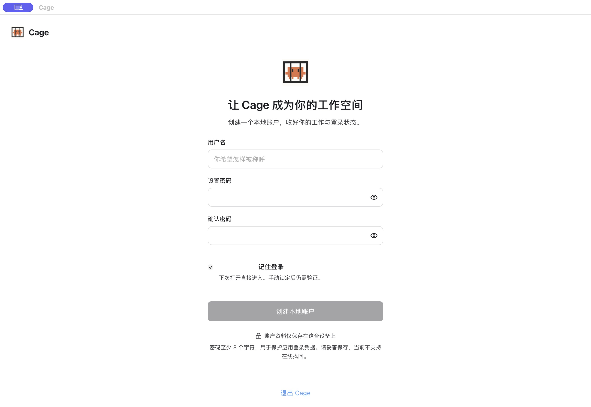
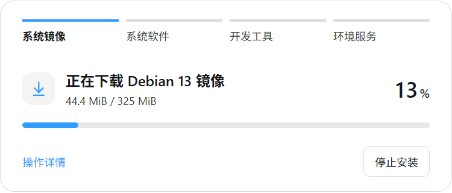

## 选择安装包

从[官网下载区](https://github.com/tan396222-prog/Claude-AntiBan/releases)选择平台。公开附件、签名和校验文件以 [GitHub Releases](https://github.com/tan396222-prog/Claude-AntiBan/releases)为准。源码压缩包用于开发，不能直接安装。

| 平台 | 要求与安装方式 |
| --- | --- |
| macOS | Apple Silicon、macOS 14+。打开 `.dmg`，将 Cage 拖入“应用程序”，再从那里启动。Intel Mac 暂不支持。 |
| Windows | Windows 10 22H2 / 11、x64。运行 `.exe` 安装器，按所选客机准备 Hyper-V 或 Windows 虚拟机监控程序平台，并在系统要求时重启。未签名预览包会明确标注。 |
| Linux | Debian 12 / Ubuntu 22.04 / 24.04、x86_64。需要 KVM 与当前用户的访问权限。执行 `sudo apt install ./Cage-<版本>-linux-amd64.deb` 补齐应用依赖，再从应用菜单打开。 |

Windows ARM64 和 Linux ARM64 暂不支持。平台依赖详情见 [Windows 指南](https://github.com/tan396222-prog/Claude-AntiBan/blob/main/docs/windows.md)与 [Linux 指南](https://github.com/tan396222-prog/Claude-AntiBan/blob/main/docs/linux.md)。

这里选择的是运行 Cage 的主机平台。虚拟机里的客机系统在首次创建环境时选择：Apple 芯片 Mac 可用 macOS 或 Debian；具备完整 Hyper-V 的 Windows 11 专业版、企业版和教育版可用 Windows 11 或 Debian；Linux 主机可选择与本机同发行版的系统或 Debian 13。具体组合见[选择客机系统](guest-systems.md)。Cage 的 macOS 14+ 运行要求与系统克隆条件分别判断；当前 Mac 克隆入口要求 macOS 26.4+。

<figure class="guide-shot">
  
  <figcaption>首次创建 Cage 账户。截图版本：0.1.6-alpha-preview（开发构建） · macOS 原生应用 · 2026-11-07。<a href="../../www/public/docs/screenshots/account-setup.jpg" target="_blank" rel="noopener">查看原图（2560 × 1764） ↗</a></figcaption>
</figure>

## 创建 Cage 账户

选择用户名和密码登录时，设置用户名和至少 8 个字符的密码。这个账户用于解锁当前 Cage，Claude 订阅需要另外在环境里登录。当前没有在线密码找回，请保存好密码。

包含本机信任登录的较新桌面构建还可选择“信任此电脑并进入”，也可选“使用用户名和密码”进入下图所示的流程。已有密码账户保持原来的登录方式；本机信任的适用范围见[受信任的本机登录](https://github.com/tan396222-prog/Claude-AntiBan/blob/main/docs/getting-started.md#受信任的本机登录)。

完整桌面版在创建密码账户时默认勾选“记住我”，可以取消；已有账户可在登录页或“设置 → 账户”调整。macOS 另可开启 Touch ID。手动锁定后仍需验证，退出账户会撤销快捷登录授权。账户密码不会加密整个项目目录或虚拟磁盘。

若以前已有账户，现在再次出现创建页面，先停止操作并查[数据目录问题](troubleshooting.md#原账户与数据看不见了)。

## 初始化系统与存储

首次登录后，Cage 显示独立的初始化界面。先选择适合项目的客机系统，可选择“自动匹配本机系统版本”或具体系统。自动匹配在下一步显示对应的官方镜像，安装干净的独立系统，主机个人文件与登录资料不会复制。以后启动沿用原系统和磁盘，更新 Cage 不会替换客机系统。

“存储目录”已填入默认位置。需要更换时直接编辑，或点击“选择文件夹”选定本地磁盘上的专用空文件夹；点击“下一步：配置代理”时保存，目录无效时留在当前页提示修改。Windows 安装器里的程序目录与环境数据目录分开；例如应用装在 C 盘，环境可放在 `D:\CageData`。

Mac、Linux 使用默认配置时，环境数据放在用户主目录的 `.claude-cage/state`。Windows 正式安装版在首次初始化时，默认填入安装目录下的 `CageData`，例如应用装在 `D:\Cage`，环境数据就放在 `D:\Cage\CageData`；没有写入权限时，在当前字段选择其他有权限的本地文件夹。已有环境继续使用原存储位置，不会自动迁移。账户与配置仍保存在用户目录的 `.claude-cage`。

初始化页显示本机完整路径。系统镜像、后续镜像下载缓存与持久虚拟磁盘使用同一存储位置；旧版本已留在系统缓存目录的文件不自动移动或删除。更新、重装与卸载应用保留环境数据目录，重新安装后可以继续使用已有数据。不要手动删除这个目录。

选择支持权限管理与稀疏文件的磁盘：Windows 可用 NTFS，Linux 可用 ext4 / XFS / Btrfs，macOS 使用已启用所有权的 APFS。不要选择磁盘根目录、网络盘、已有项目或应用安装目录。已有环境换盘请按[存储迁移](maintenance.md#迁移环境到另一块磁盘)操作。

## 导入代理并启动

1. 点击“下一步：配置代理”，添加 Clash/Mihomo YAML 订阅、本地配置或手动 HTTP/SOCKS5 节点。详细步骤见[网络与代理](network.md)。
2. 选择最终出口，点击“应用代理”。Cage 使用独立核心，不会自动采用本机 Clash 当前所选节点。
3. 核对匹配的系统镜像、下载量和空间要求，点击“开始安装”。需要启用 Git 保护时，在初始化界面阅读影响并确认启用，再继续安装。
4. 留在初始化界面查看下载、校验、系统安装和工具配置进度。macOS 客机安装后自动登录，并逐项打开需要确认的权限页面；按画面说明打开对应开关即可，「文件系统扩展」按钮会直接展开正确面板。授权通过后 Cage 自动检查并继续。失败时在原界面检查代理、查看操作详情或导出诊断，点击“继续安装”恢复。
5. 客机可用且网络与隔离检查通过后，点击“进入工作台”。以后打开 Cage 直接进入原工作台，环境停止时可以直接启动使用。只需连接远程服务器时，初始化界面的“只连接 SSH 主机”可跳过本机安装。

Git 保护会修改当前主机用户的全局 `safe.bareRepository=explicit`，影响本机其他 Git 工具；普通 `.git` 项目操作不变，裸仓库需明确指定路径。只有你确认后才写入设置。

## 第一次启动需要等待什么

首次安装内容取决于客机系统。克隆入口优先复用已校验的匹配材料，缺少时下载官方镜像。macOS 使用 Apple IPSW；Windows 克隆使用匹配的 Microsoft ESD，手动安装可选择官方 ISO；Linux 克隆使用对应发行版的云镜像。Debian 13 基础镜像约 320–325 MiB，开发工具另行安装。镜像来源、系统许可和存储要求见[客机系统指南](guest-systems.md#下载量与磁盘空间)。

系统镜像、镜像版本目录和在主机上预备的 macOS 应用与开发工具包通过主机网络下载，遵循主机代理设置；未配置代理时直连官方源。使用 Clash 等软件时，可开启其系统代理或 TUN，实际出口由该软件对下载网站的规则决定。已选择的主机代理连接失败、明确配置的 PAC 解析失败时，下载会报错，不自动回退直连。客机内的进程和下载任务使用 Cage 的独立代理，官方源与备用镜像的选择及平台设置见[系统镜像的下载网络](network.md#系统镜像的下载网络)。

Debian 初始虚拟磁盘容量上限为 24 GiB，macOS 和 Windows 需为系统及开发工具留出更多空间。实际占用随安装和使用增加，创建前查看所选版本的要求。Claude Desktop 按需单独下载。随后启动会复用工具、文件与登录资料。

下载中断时查看错误，修复网络或磁盘空间后点“继续安装”。有固定 SHA-256 摘要的 macOS 应用与开发工具包会尝试续传，收齐后校验整份文件。摘要不符或服务器不支持续传时，从头下载该文件。Chrome 使用随版本更新的下载地址，中断后会重新下载整个安装包。不要通过清空 `.claude-cage` 或重建账户解决安装失败。

下载时显示已接收字节、可取得的总量与采样速度；校验单独显示处理进度。系统恢复和工具安装没有可测总量时显示阶段。继续安装沿用原安装身份、系统选择和已创建磁盘。

<figure class="guide-shot">
  
  <figcaption>Windows 原生应用首次下载镜像的进度。截图版本：0.1.5-alpha.2（测试构建） · Windows 11 x64 原生应用 · 2026-11-06。<a href="../../www/public/docs/screenshots/windows-native-download.png" target="_blank" rel="noopener">查看原图（750 × 320） ↗</a></figcaption>
</figure>

## 完成第一项工作

点项目旁加号打开自己的目录，用“新建 Claude 终端”完成环境内的授权。先让 Claude 读取一个文件或完成小修改，在主机检查结果后再投入正式任务。文件、终端和上传操作见[项目、终端与文件](workbench.md)。
