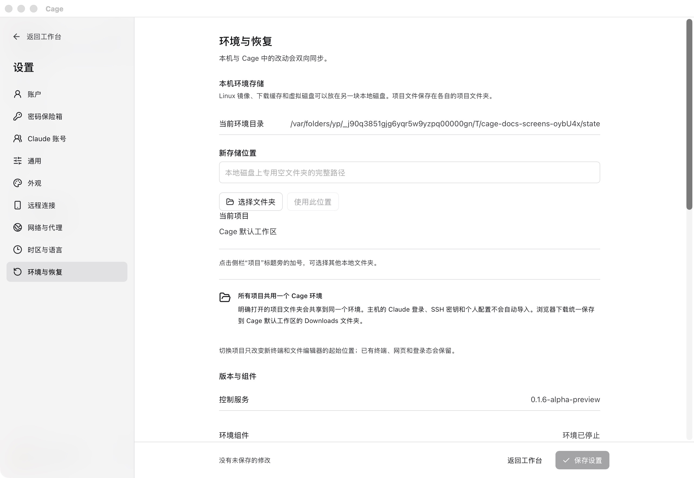
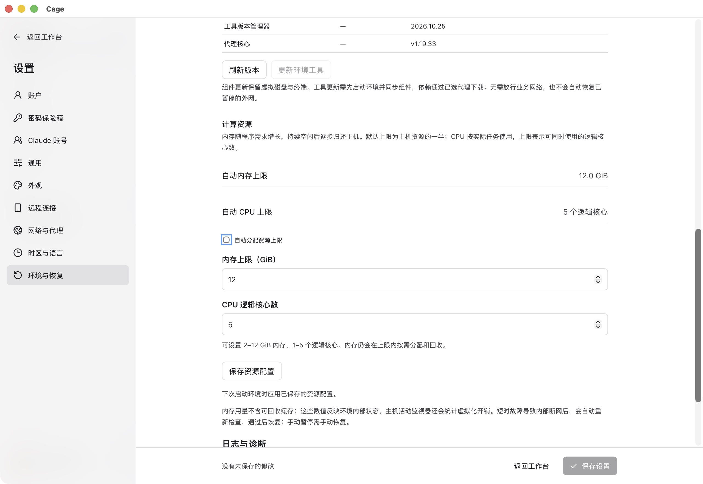
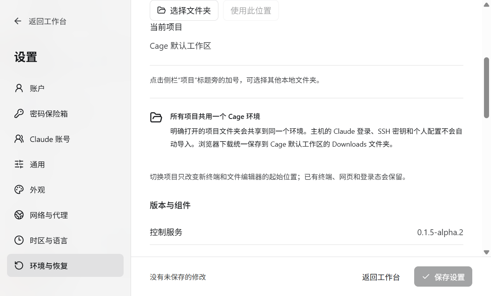

## 数据保存在哪里

默认配置根位于当前用户主目录下的 `.claude-cage`。账户、设置、收藏与密码库属于配置数据；浏览器历史、网站登录、工具与环境内文件还依赖持久虚拟磁盘。本机共享项目保存在原项目目录。指定 `CLAUDE_CAGE_CONFIG` 时，后续启动和维护应继续使用同一个绝对路径。

云端的数据在服务器上，包含配置、项目及容器引擎的持久文件系统。本机只保留连接和明确下载的副本。不要仅备份一份账户文件，或把重建账户当作恢复。

<figure class="guide-shot">
  
  <figcaption>环境存储位置与版本组件入口。截图版本：0.1.6-alpha-preview（开发构建） · macOS 原生应用 · 2026-11-07。<a href="../../www/public/docs/screenshots/environment-maintenance.jpg" target="_blank" rel="noopener">查看原图（2560 × 1764） ↗</a></figcaption>
</figure>

## 迁移环境到另一块磁盘

入口：“设置 → 环境与恢复 → 本机环境存储”。此功能针对本机 VM，云端容器按服务器部署方案维护。

1. 保存编辑器和终端中的工作，选择本地磁盘上的专用空目录。不要选盘根目录、网络盘、程序目录、配置目录或项目目录。
2. 确认迁移。Cage 会停止环境和终端，复制并校验数据，成功后切换存储路径。
3. 手动启动环境，核对文件、浏览器登录和工具。
4. 确认正常后，再通过面板清理本次迁移显示的旧备份。旧缓存可能供其他 Lima 实例使用，会留在原位置。

目标盘须有足够空间并支持权限和稀疏文件。外接盘以后每次启动前都要接回；找不到磁盘时先连接原盘，不要新建环境覆盖状态。

<figure class="guide-shot">
  
  <figcaption>手动调整内存与 CPU 上限的表单。截图版本：0.1.6-alpha-preview（开发构建） · macOS 原生应用 · 2026-11-07。<a href="../../www/public/docs/screenshots/resources-manual.jpg" target="_blank" rel="noopener">查看原图（2560 × 1764） ↗</a></figcaption>
</figure>

## 设置 CPU 与内存

入口：“设置 → 环境与恢复 → 计算资源”。默认自动分配本机资源上限，实际范围由主机与平台决定。需要手动控制时关闭“自动分配资源上限”，在页面允许范围内填写内存 GiB 和逻辑 CPU 核心数。

点“保存资源配置”后下次启动生效。运行中可“重启并应用已保存配置”，先保存工作，重启会结束正在执行的命令。内存可以在上限内按需增长与回收，设置上限不会使所有内存一直占满。

云端资源由服务器部署限制，工作台显示核验信息，不能按本机 VM 的方式承诺编辑或实时统计。任务退出 137 时结合 OOM 计数和诊断判断，避免只凭退出码认定内存不足。

## 区分三种更新

| 更新对象 | 在哪里操作 | 影响 |
| --- | --- | --- |
| 桌面 Cage 应用 | 应用更新入口，或下载完整安装包手动替换 | 安装会结束相关环境与终端；保留持久数据。云端服务单独维护。 |
| 环境组件 | 设置 → 环境与恢复 → 版本与组件 → 更新环境组件 | 可能重启浏览器和编辑器。Linux 的工作台独立终端通常保留，编辑器内终端可能结束；原生 macOS、Windows 需先结束正在使用的工作台终端与 Claude Code 轮次。 |
| 环境工具 | 同页“更新环境工具” | 按当前应用指定版本更新工具，需要环境就绪；先更新不兼容的组件。 |

操作前保存工作。替换 App 不代表持久环境中的所有组件已经更新，看到版本不匹配时按页面同步。维护下载经过所选代理，手动暂停业务外网不会被维护操作解除。

原生 macOS、Windows 的“更新环境组件”检查实际文件与当前应用的组件清单，可修复缺失或损坏组件；“更新环境工具”更新到当前应用指定的工具版本。Windows 维护还需按提示核对主机授权与客机管理员身份。失败后先查看原因，保留原配置、磁盘和恢复记录，再重试原操作；不要重新创建环境。原生 Windows 的完整提权、客机服务重启与最终签名包升级仍需单独验收。

macOS 自动安装要求相同发布者的 Developer ID 签名与 Apple 验证；Windows 需可信 Authenticode 签名和相同发布者公钥。未签名 Windows 预览版与 Linux 使用完整安装包手动更新。自动更新下载失败可在原入口重试。

<figure class="guide-shot">
  
  <figcaption>Windows 原生应用的版本与环境维护。截图版本：0.1.5-alpha.2（测试构建） · Windows 11 x64 原生应用 · 2026-11-06。<a href="../../www/public/docs/screenshots/windows-native-storage.png" target="_blank" rel="noopener">查看原图（1259 × 759） ↗</a></figcaption>
</figure>

## 恢复配置与导出诊断

“恢复上一份配置”会先停止环境，再恢复上一次保存的配置。它不能恢复已结束的命令，也不能还原项目文件修改。运行前阅读页面提示并保存内容。

同页的日志诊断可导出 ZIP。应用界面无法使用时，也可按[故障排查](troubleshooting.md#导出诊断与反馈)从命令行导出。默认日志保留 14 天，总预算 50 MiB，不以此替代自己的数据备份。

## 备份、重装与卸载

先保存文件，停止环境和相关后台，再备份完整配置根、选择的环境存储、共享项目与服务器引擎数据。完整备份需要保持同一时点的一致性；运行中的进程和临时终端输出不能靠磁盘备份恢复。

安装、重装、更新和卸载只管理应用文件，个人数据继续保留。再次安装应使用原配置与数据路径。需要换机器、回滚或手动迁移时，先核对账户、收藏、密码库和持久磁盘能一起恢复。

Windows 安装器会保留程序目录内的已有项目、文件和链接。与新版程序同名的修改文件，以及程序装载目录中无法确认归属的旧可执行库，保存在安装目录的 `Cage-preserved-files` 子目录。安装期间出现的额外修改也可能保存在该目录的 `late-` 子目录中。卸载后若仍有个人文件，安装目录会继续保留，再次安装可以沿用这个目录。

Windows 安装恢复被文件占用或路径冲突阻断时，安装目录旁会保留同名的 `.cage-installation.json` 回执，其中记录原安装、候选和备份目录。请保留回执及记录的目录，按报错定位个人文件后再恢复。自动更新会停止启动未完成恢复的应用。

macOS 自动更新与开发安装会验证旧应用包的完整性，校验失败时保留旧包。旧副本清理也会保留完整性无法确认的应用包，避免移除包内新增的个人文件。

备份还需覆盖客机的完整身份：macOS 的系统盘、虚拟硬件型号、机器标识和辅助存储应一并保存；Windows 的虚拟机配置、系统盘和关联虚拟 TPM 状态应一并保存。更换客机系统需要独立安装，保留原环境，不能用重建账户或初始化原磁盘完成转换。见[已有环境与更换系统](guest-systems.md#已有环境与更换系统)。

不要对用户数据执行初始化、批量删除容器或 `docker system prune` 来解决更新失败。恢复前保留原件与备份，遇到原账户消失先查[数据目录](troubleshooting.md#原账户与数据看不见了)。
