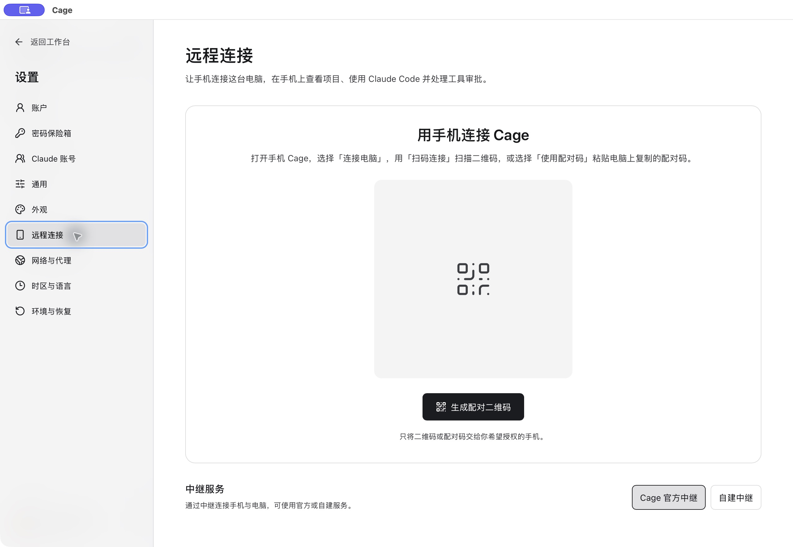
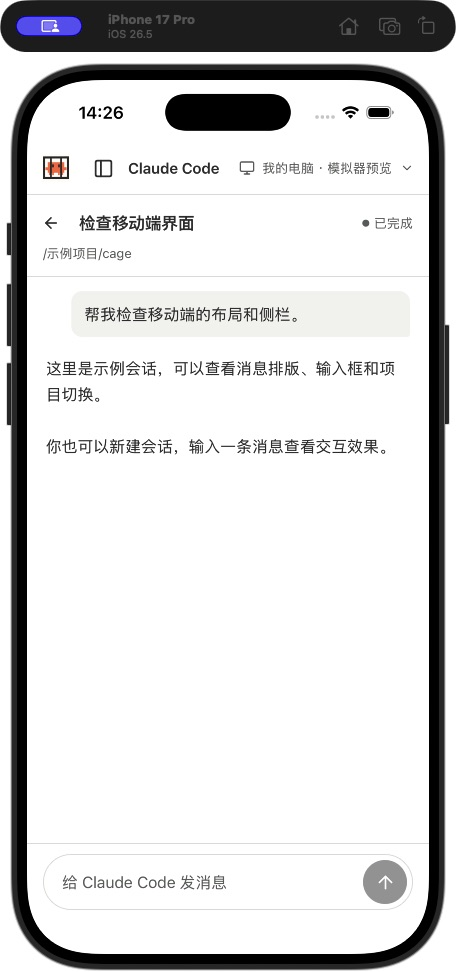

## 获取客户端与使用条件

手机 Cage 当前为开发版：Android 提供 arm64 调试构建，iPhone 需用 Xcode 为自己的测试设备签名安装。尚无应用商店安装入口；不要把桌面 DMG、EXE 或 DEB 当作手机安装包。Android 需要 8.0 及更新的 arm64 设备和现代 System WebView；iPhone 需要 iOS 17+ 与 Secure Enclave。设备安装包及签名须来自与你的电脑端匹配的开发构建。

电脑需运行包含移动功能的 Cage、解锁账户并准备好环境。手机只负责连接与显示，Claude Code、网络出口、时区和语言由配对电脑上的 Cage 管理。电脑离线或停止环境后，手机无法继续在该环境运行任务。

桌面通过 SSH 切到服务器时，手机接口仍指向原电脑的本机 Cage。请切回本机工作台管理手机配对。

<figure class="guide-shot">
  
  <figcaption>电脑端的手机配对入口与中继选择。截图版本：0.1.6-alpha-preview（开发构建） · macOS 原生应用 · 2026-11-07。<a href="../../www/public/docs/screenshots/mobile-pairing.jpg" target="_blank" rel="noopener">查看原图（2560 × 1764） ↗</a></figcaption>
</figure>

## 扫码或使用配对码

1. 电脑进入“设置 → 远程连接 → 手机连接”，点“生成配对二维码”。二维码约两分钟有效，过期后刷新。
2. 手机首页点“连接电脑 → 扫码连接”，允许相机并扫描完整二维码。
3. 相机不方便时，在电脑点“复制配对码”，手机选择配对码入口，粘贴这串一次性代码。
4. 连接成功后选择已授权项目。下次可在“连接电脑”里重新连接已配对设备。

配对码授予设备访问，请只交给你要授权的手机。电脑锁定、刷新或超时会使尚未使用的代码失效。电脑重启后先启动 Cage，再重新连接。

## 创建会话与处理工具审批

选择项目，新建会话并发送消息。手机可查看回复、执行进度与保存的历史，运行时可以停止本轮。没有项目时，先在电脑工作台明确添加一个目录。

需要执行工具时，手机显示工具名称和参数，选择“允许一次”或“拒绝”。先检查参数中的命令、文件路径和操作范围。同一项审批若已被另一端处理，重新读取最新状态。

这里管理通过 Cage 会话界面创建的结构化 Claude Code 对话。普通终端里手工启动的 CLI 仍在原终端操作，当前不能承诺接管任意活跃终端。续聊会检查账号与服务地址，身份变化时拒绝继续；无法核实身份的配置只支持首轮，可按提示新建会话。

<figure class="guide-shot guide-shot-phone">
  
  <figcaption>手机原生客户端的会话界面预览。截图版本：Cage iOS 0.1（build 1，开发版） · iPhone 17 Pro 模拟器 · iOS 26.5 · 2026-11-07 · 界面预览，示例对话，未连接主机。<a href="../../www/public/docs/screenshots/mobile-ios-preview.jpg" target="_blank" rel="noopener">查看原图（456 × 972） ↗</a></figcaption>
</figure>

## 在手机打开远程浏览器

1. 电脑启动环境并通过网络检查。
2. 电脑在已配对手机下开启“允许这部手机使用远程浏览器”。
3. 手机会话列表点“远程浏览器”，输入公网网址或打开 Claude.ai。
4. 点击网页输入框，再用“输入文字”调用手机键盘；点勾号插入，需要提交时再点“发送回车”。

网页在电脑的 Cage 中运行，每部配对手机使用独立浏览资料，首次需要在这份窗口里登录。普通关闭保留该配对的登录资料；撤销权限、移除配对或锁定电脑会中止访问。

当前显示单个网页，支持公网 IPv4 的 HTTP/HTTPS。弹窗登录、附件上传下载、声音播放及 Claude Desktop 控制尚未接入。模拟器的扫码预览只演示会话界面，不能据此验收真实配对和浏览器。

## 断网、切换设备与撤销

短暂断网后先留在当前会话，网络恢复时读取最新进度，会重新核对电脑身份。输入草稿保留；发送或审批时断线，先确认主机记录，避免重复操作。主机已接受的任务可以继续运行。

左上角 Logo 返回首页，设备连接保留。设备列表可以切换电脑；长按设备并确认“取消连接”只关闭这次连接，配对记录继续保留。在手机“忘记主机”清除本机保存的连接；要撤销电脑端授权，还要在电脑“设置 → 远程连接”移除对应配对。

## 使用自建中继

电脑在“设置 → 远程连接”选择自建中继并保存 HTTPS 地址，手机设置也填写同一地址。需管理令牌时只在电脑填写。保存后再生成新配对码，已有配对不会自动搬到另一台中继，迁移需撤销并重新配对。

中继转发连接，不运行你的项目。它可以看到连接地址、时间和流量大小；电脑与手机在转发通道内核对身份并加密通信。自建中继需使用与手机协议匹配的部署程序。相应部署材料和命令行连接助手随移动开发工作区提供；仅有桌面公开安装包时，请先等待配套移动功能发布。
