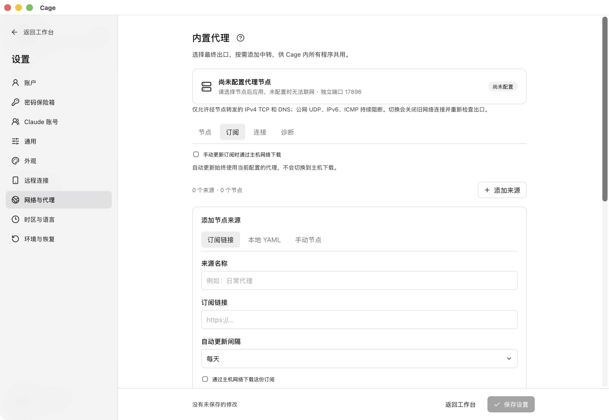
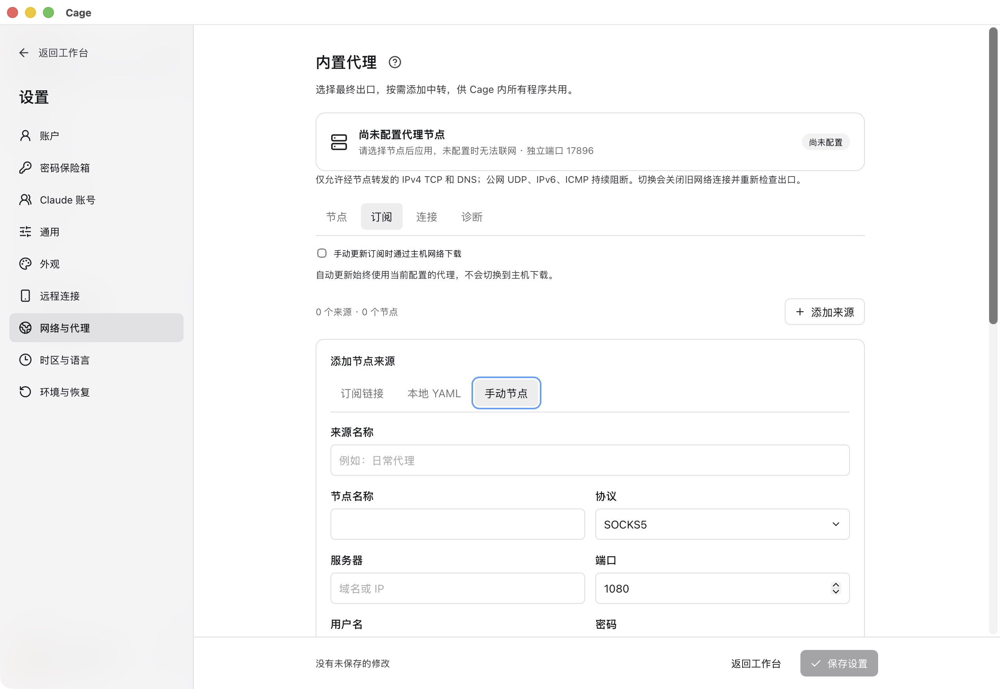
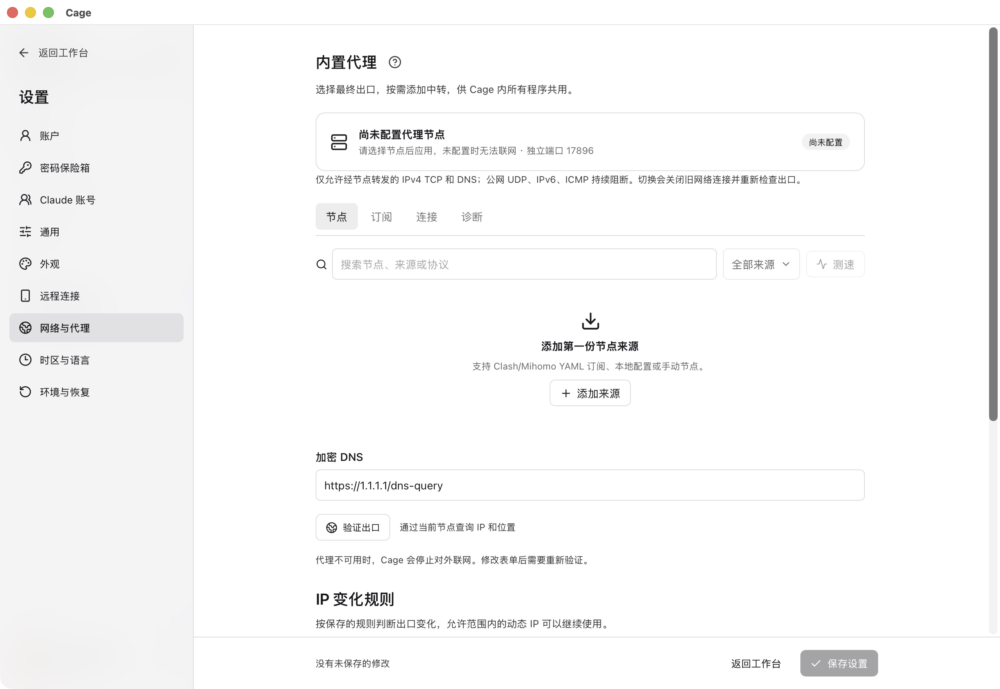
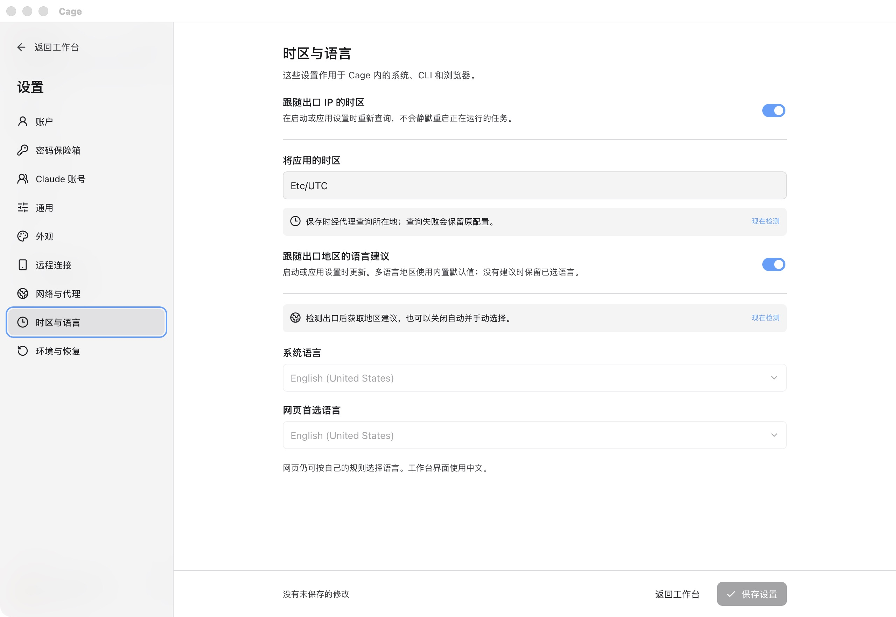

<figure class="guide-shot">
  
  <figcaption>添加订阅链接与首次主机下载选项。截图版本：0.1.6-alpha-preview（开发构建） · macOS 原生应用 · 2026-11-07。<a href="../../www/public/docs/screenshots/proxy-subscription.jpg" target="_blank" rel="noopener">查看原图（2560 × 1764） ↗</a></figcaption>
</figure>

## 导入自己的代理

入口是首页“配置网络与代理”，或“设置 → 网络与代理”。点击“添加来源”，选择导入方式：

| 来源 | 怎么填 |
| --- | --- |
| 订阅链接 | 输入名称和 HTTPS 节点订阅地址。首次没有可用节点时，可明确勾选“通过主机网络下载这份订阅”。 |
| 本地 YAML | 选择导出的文件，或粘贴 Clash/Mihomo YAML 内容。 |
| 手动节点 | 填写 HTTP 或 SOCKS5 服务器、端口和对应认证字段。 |

点击“导入并验证”，进入“节点”，选最终出口，再点“应用代理”。“保存设置”用于其他设置，不能替代应用代理。未应用的选择只是草稿。

订阅必须包含 `proxies` 或 `payload` 节点。Base64 列表、单个节点分享链接、只引用远程 provider 的配置暂不支持。导入只采用支持的节点与代理链，不采用订阅中的主机系统代理、TUN、监听端口或直连规则。

<figure class="guide-shot">
  
  <figcaption>手动填写 HTTP / SOCKS5 节点。截图版本：0.1.6-alpha-preview（开发构建） · macOS 原生应用 · 2026-11-07。<a href="../../www/public/docs/screenshots/proxy-manual.jpg" target="_blank" rel="noopener">查看原图（2560 × 1764） ↗</a></figcaption>
</figure>

## 通过中转连接住宅出口

如果住宅节点无法直接连接，在“节点”页切换到“链式代理”。按连接顺序选择中转，将住宅节点设为“最终出口”；需要多次中转时点“添加中转”。节点可以来自不同来源。

应用前检查预览，例如：`Cage → 中转节点 → 住宅代理 → 目标网站`。目标网站看到的是最终出口。订阅更新不会覆盖已保存的组合；使用中的节点被移除时会保留原配置并显示错误，需要你重新选择。

<figure class="guide-shot">
  
  <figcaption>网络与代理页面及出口变化规则。截图版本：0.1.6-alpha-preview（开发构建） · macOS 原生应用 · 2026-11-07。<a href="../../www/public/docs/screenshots/network-settings.jpg" target="_blank" rel="noopener">查看原图（2560 × 1764） ↗</a></figcaption>
</figure>

## 为什么应用了节点仍然离线

代理核心就绪和工作环境获准联网是两个步骤。环境启动后先保持业务外网关闭，执行出口、DNS、系统与浏览器配置、共享目录、宿主管理接口和网络阻断等关键检查。任一关键项失败或证据缺失都会继续关闭外网。

点击底部网络状态查看失败项，修复后重新检查。核心运行但环境未启动时会显示“待启动环境”。关键检查通过、联网授权有效时才显示“已联网”。

离线时仍可使用终端、共享文件及环境内的本地服务。浏览器地址栏中的 `localhost` 指 Cage 的 Linux 环境；开发服务应在 Cage 终端里启动。

<figure class="guide-shot">
  
  <figcaption>跟随出口 IP 的时区与语言设置。截图版本：0.1.6-alpha-preview（开发构建） · macOS 原生应用 · 2026-11-07。<a href="../../www/public/docs/screenshots/region-settings.jpg" target="_blank" rel="noopener">查看原图（2560 × 1764） ↗</a></figcaption>
</figure>

## 时区、语言与出口规则

在“设置 → 时区与语言”选择跟随出口或手动设置。自动模式通过代理查询出口位置，不使用主机位置替代。位置服务失败时可重试，或按页面入口手动设置；地区限制规则仍需要有效位置证据。

网络页的“IP 变化规则”支持静态 IP，以及动态 IP 的同一城市、同一国家／地区或不限地区。城市模式还检查国家与州省。已保存的出口基准只有明确修改后才改变，重新检查不会自动接受新地址。

保存影响系统环境的配置可能要求重启。先保存文件；运行中不会因后台发现位置变化而静默重启任务。

## 暂停、恢复和网络切换

点击底部状态可手动暂停外网。暂停会切断已有外部连接，保留本地任务和文件操作；关闭、重开 Cage 或刷新订阅不会解除手动暂停。

后台会定期核对出口与环境配置。发现不符时暂停，主机切换网络后会尝试恢复并完整复检；原先人为暂停的状态仍需主动恢复。控制服务失联后，已有网络授权到期关闭。固定出口还需要代理服务本身保证，周期采样不能证明所有连接都走同一 IP。

## DNS 与诊断

业务 DNS 通过所选代理转发。节点域名的启动解析属于准备通信，与客机业务 DNS 的设置分开。Cage 不修改主机系统代理或 TUN，也不改变本机其他代理软件的节点。

代理页“诊断”可检查核心状态、重启 Cage 核心或选择独立监听端口。端口占用时选择未占用端口即可，修改后按提示重启环境。具体症状见[故障排查](troubleshooting.md#节点已应用但无法联网)。
