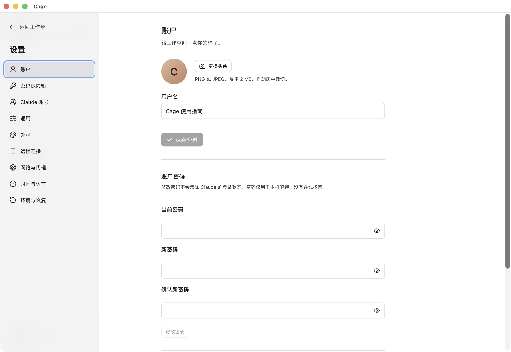
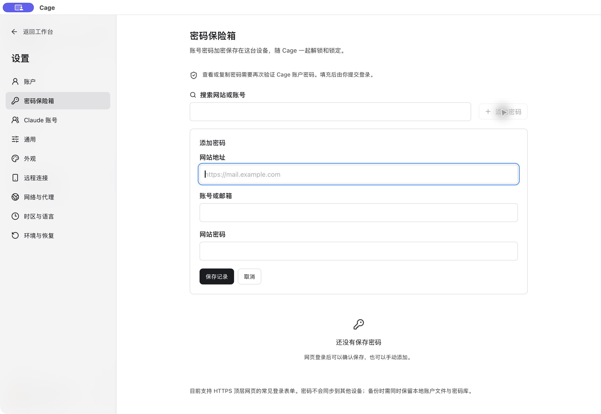
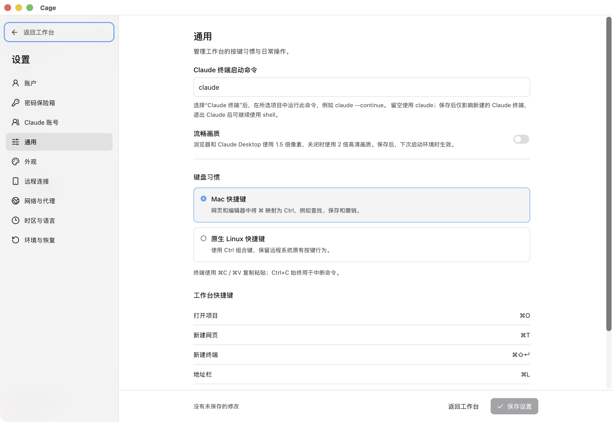
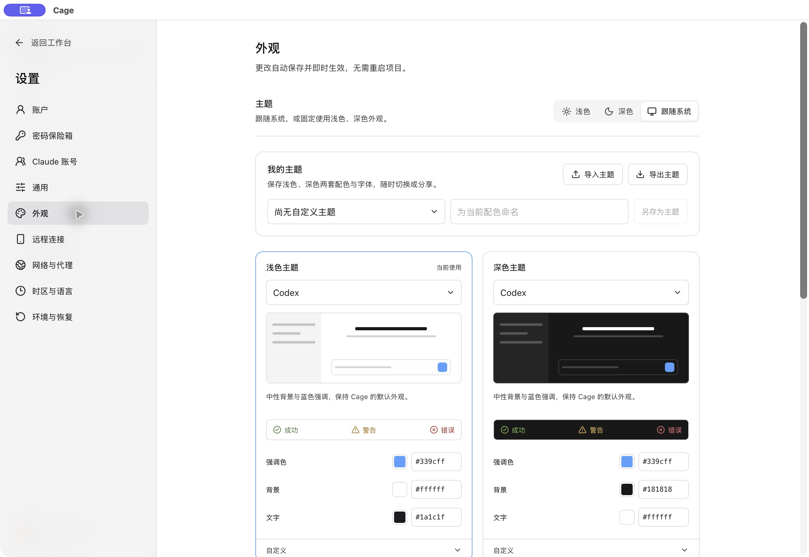

## 打开设置与保存

点击左下角头像菜单中的“设置”。网络与系统配置修改后按页面的“保存设置”应用；需要重启时会提醒先保存文件，重启会结束终端命令。代理节点用“应用代理”单独应用。

外观调整即时生效并自动保存，保存失败可“重试保存”。远程客户端的键盘与布局偏好保存在当前电脑，不代表更改服务器运行环境。

## 设置菜单总览

| 入口 | 可以设置什么 | 何时生效 |
| --- | --- | --- |
| 账户 | 头像、用户名、密码、支持时的记住登录与 Touch ID | 按账户页保存；锁定后仍需验证 |
| 密码保险箱 | 网站账号、密码记录和保存提示 | 记录操作后生效；查看复制需验证 |
| Claude 账号 | 登录多个订阅、备注、检查额度、参与调度 | 分配选项影响新建 Claude 终端 |
| 通用 | 键盘习惯、Claude 终端启动命令、浏览器默认网站、流畅画质 | 依具体项，新终端、新页面或下次环境启动 |
| 外观 | 明暗主题、颜色、字体、字号、终端与交互偏好 | 即时预览并自动保存 |
| 远程连接 | 本机手机配对、远程浏览器授权、官方或自建中继 | 保存后生效；中继迁移需重新配对 |
| 网络与代理 | 来源、节点、代理链、DNS、出口规则及核心诊断 | 应用代理或保存，部分更改需重启 |
| 时区与语言 | 自动跟随出口，或手动指定系统与浏览器语言 | 应用并按提示重启 |
| 环境与恢复 | 存储、资源、组件工具版本、配置恢复、诊断 | 具体影响见[维护说明](maintenance.md) |

<figure class="guide-shot">
  
  <figcaption>账户资料、密码与登录解锁设置。截图版本：0.1.6-alpha-preview（开发构建） · macOS 原生应用 · 2026-11-07。<a href="../../www/public/docs/screenshots/account-settings.jpg" target="_blank" rel="noopener">查看原图（2560 × 1764） ↗</a></figcaption>
</figure>

## 账户与登录

Cage 账户只用于当前环境解锁，没有在线找回。在云端工作台修改的是服务器账户。macOS 支持的记住登录和 Touch ID 与系统钥匙串绑定；迁移配置目录后可能需要用原密码重新授权。

“锁定 Cage”保留后台任务，“退出账户”会停止环境。账户密码不等于项目磁盘加密密码。不要为了处理更新或目录问题重新创建账户。

<figure class="guide-shot">
  
  <figcaption>手动添加网站密码的表单。截图版本：0.1.6-alpha-preview（开发构建） · macOS 原生应用 · 2026-11-07。<a href="../../www/public/docs/screenshots/password-add.jpg" target="_blank" rel="noopener">查看原图（2560 × 1764） ↗</a></figcaption>
</figure>

## 密码保险箱

网页登录成功后选择保存或更新。也可在保险箱内手动添加、搜索、编辑、删除，恢复某网站的保存提示。填充后由你提交网页表单；查看和复制密码需要再次输入 Cage 密码。

当前支持 HTTPS 顶层页面常见登录表单，嵌入框架、验证码、Passkey 等不会自动处理。无痕页面不提示保存。旧环境提示不可用时，先更新环境组件。

密码记录保存在当前主机的 Cage 配置中，不跨设备自动同步；云端实例的保险箱位于服务器。备份时账户文件与密码库需一起保留。Cage 锁定时保险箱随之锁定，记住登录解锁时也可随之解锁。

<figure class="guide-shot">
  
  <figcaption>终端启动命令、画质与快捷键设置。截图版本：0.1.6-alpha-preview（开发构建） · macOS 原生应用 · 2026-11-07。<a href="../../www/public/docs/screenshots/general-settings.jpg" target="_blank" rel="noopener">查看原图（2560 × 1764） ↗</a></figcaption>
</figure>

## 通用与键盘

“Claude 终端启动命令”用于新建的 Claude 终端，例如 `claude --continue`，保存不会改变现有终端。自定义命令需与你安装的 CLI 兼容。

“按键习惯”决定工作台与远端输入的映射。Mac 模式把网页与编辑器的常见 Command 组合映射到 Linux 控件；终端 Ctrl+C 仍中断。Windows/Linux 终端复制粘贴使用 Ctrl+Shift+C/V。

“浏览器默认网站”用于之后新建的网页。“流畅画质”降低绘图密度以改善滚动，保存后在下次环境启动生效。浏览器本身的标签布局与网站数据在独立浏览器设置中管理。

<figure class="guide-shot">
  
  <figcaption>浅色、深色与自定义主题。截图版本：0.1.6-alpha-preview（开发构建） · macOS 原生应用 · 2026-11-07。<a href="../../www/public/docs/screenshots/appearance.jpg" target="_blank" rel="noopener">查看原图（2560 × 1764） ↗</a></figcaption>
</figure>

## 外观、主题与无障碍

可跟随系统或固定浅色、深色。预设包含编辑器、阅读与无障碍等系列；选择预设会应用界面与终端配色，保留字体，替换当前元素颜色覆盖。

自定义可调整强调色、背景、文字、侧栏、边框、按钮、焦点、状态，以及终端 ANSI 配色。字体、字号、对比度、指针和动态效果也在这里调整。蓝橙色觉友好和高对比预设减少对红绿区分的依赖，可结合状态图标与文字检查效果。

“我的主题”可另存、更新或恢复已保存配色，最多 50 个。导入导出使用 `.cage-theme.json`，不包含账户、节点、项目和本机路径；明暗切换模式、字号及交互偏好不随主题文件迁移。文件上限 256 KB，格式无效会保留当前设置。

支持时可“从本机 Codex 同步”外观偏好，导入后由 Cage 独立保存。虚拟环境中的网页和编辑器保留它们各自的主题。

## 时区、语言与远程连接

自动时区和语言使用代理出口定位，手动选择不会被主机位置代替。应用后可能重启环境，详见[时区与出口规则](network.md#时区语言与出口规则)。

“远程连接”中的手机配对针对本机 Cage。先切回本机，再生成配对码或撤销手机浏览器权限。SSH 主机在工作台侧栏管理；手机中继和云端运行环境是不同的服务，分别见[手机连接](mobile.md)与[云端部署](cloud.md)。
