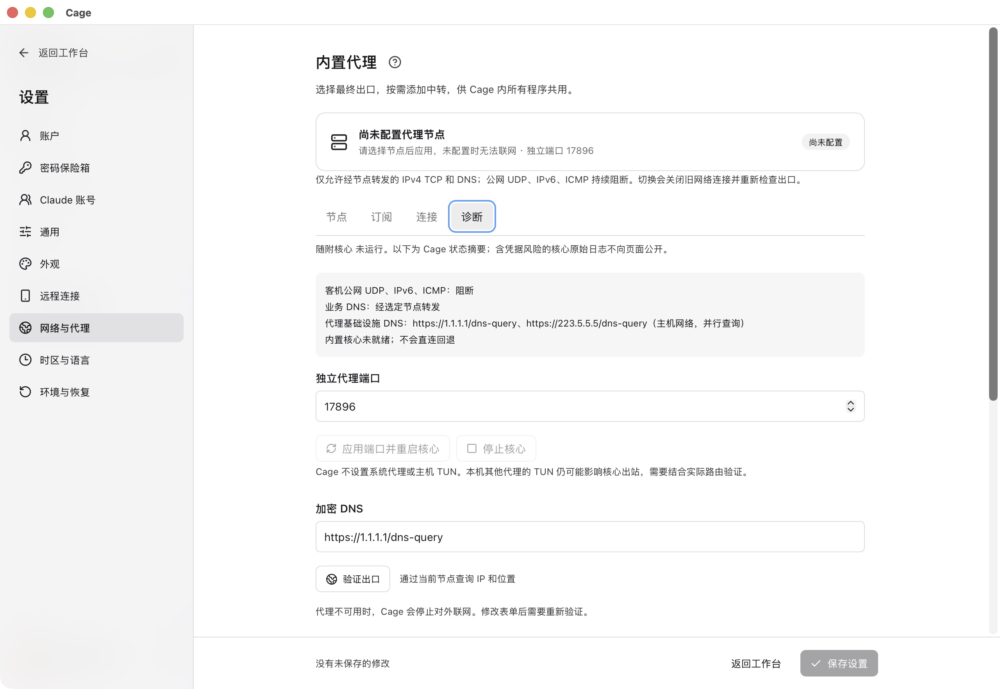
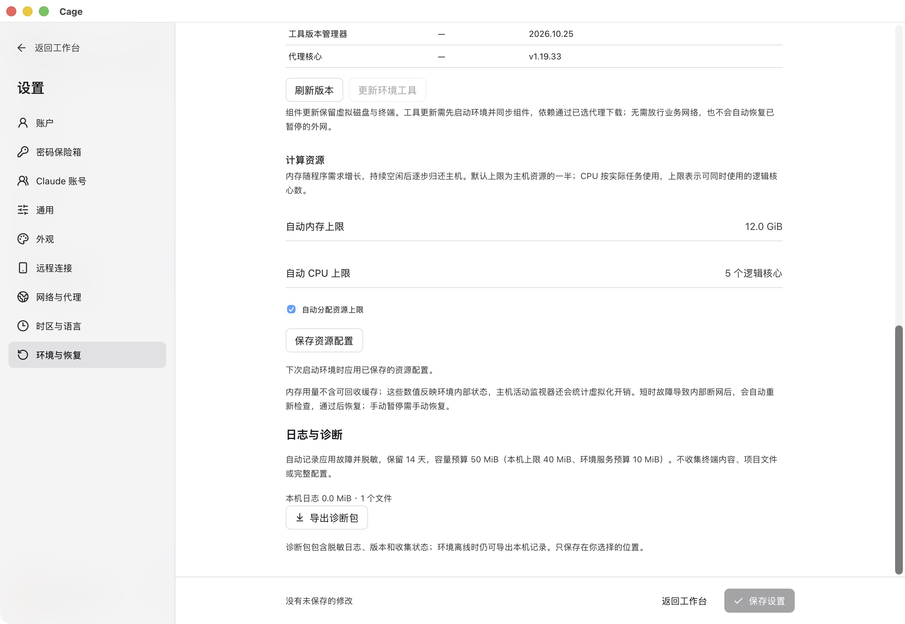

先核对当前主机、Cage 版本和报错原文。操作结果不确定时先读取最新状态，再决定重试。不要用清空个人目录、删除虚拟磁盘或重建账户作为常规排障手段。

## 下载或安装失败

| 现象 | 处理方式 |
| --- | --- |
| GitHub 404 或没有安装包 | 从官网下载区选择平台，确认 Release 公开且链接完整。源码 ZIP 不能当安装包。 |
| Mac 显示损坏、无法验证或不支持 | 核对 Apple Silicon、macOS 14+，重新下载完整 DMG，检查该版签名、公证和校验说明。保留系统原文，不关闭系统验证来掩盖问题。 |
| Windows 未知发布者 | 确认是否为明确标注的未签名预览，阅读对应发行说明；不能把它当作已签名发行。 |
| Windows 启动虚拟机失败 | 检查 BIOS/UEFI 虚拟化和“Windows 虚拟机监控程序平台”，启用后重启。保留 WHPX 错误原文供定位。 |
| Linux 无法启动 | 确认 x86_64、支持发行版与 KVM 权限，使用 APT 补齐安装依赖。 |
| 缺少代理核心 | 重装对应平台完整应用，不要只复制单个命令行文件。 |

## 准备环境卡住或反复下载

打开“操作详情”区分仍在下载、安装依赖和已经失败。检查节点、剩余磁盘和存储盘连接后，点“继续安装”。仍有数据持续接收时可以等待，完整性校验未通过的文件不能使用。

| 错误 | 下一步 |
| --- | --- |
| `Download interrupted` / `partial data retained` | 未完成文件已保留，修复网络后重试续传。 |
| `checksum mismatch` | 文件摘要不符，重新下载，不跳过校验。 |
| `Guest DNS could not resolve` | 检查节点及 DNS 配置，应用后重试。 |
| NodeSource / APT 失败 | 查看失败来源，检查代理访问；保存具体错误与诊断。 |
| APT 重复 `Tried to start delayed item` | 更新到包含 APT 修正的构建，旧版依赖管理器升级失败时先修复网络，不能继续依赖安装。 |

Git 前置检查未通过时，按提示更新本机 Git 至 2.38+、检查全局配置写入权限或重新检查；不必重配节点。启用保护会影响主机全局 Git，先阅读确认卡片。

<figure class="guide-shot">
  <a href="../../www/public/docs/screenshots/proxy-diagnostics.jpg" target="_blank" rel="noopener" aria-label="查看原图：代理核心状态与独立端口诊断"></a>
  <figcaption>代理核心状态与独立端口诊断。截图版本：0.1.6-alpha-preview（开发构建） · macOS 原生应用 · 2026-11-07。<a href="../../www/public/docs/screenshots/proxy-diagnostics.jpg" target="_blank" rel="noopener">查看原图（2560 × 1764） ↗</a></figcaption>
</figure>

## 节点已应用但无法联网

点底部网络状态查看具体关键项。“已应用”只表示节点选择成功，外网还需检查通过。

| 状态 | 处理方式 |
| --- | --- |
| 出口不符合静态 IP、城市或国家规则 | 换回符合原规则的节点；确实要换基准时明确修改 IP 规则。重检不会自动接受新 IP。 |
| 代理核心未就绪 | 进入代理诊断检查状态，重新应用节点或重启 Cage 核心。 |
| 端口占用 | 选一个未占用的 Cage 独立端口，按提示重启，无需终止其他代理。 |
| 位置查询失败 | 重试或换节点，也可手动设置时区和语言；地区限制模式仍需位置证据。 |
| 手动暂停或报告过期 | 确认后主动重新检查，全部关键项通过才恢复。 |
| 主机切网后离线 | 等待恢复和完整复检；原手动暂停不会自行解除。 |

本机浏览器可联网不能证明 Cage 代理已经配置。订阅无节点时检查是不是含 `proxies` / `payload` 的 YAML；不要把私人订阅上传到在线转换网站或 Issue。

## 任务退出 137 或重任务后断网

137 表示被强制终止，无法独立证明 OOM。到“设置 → 环境与恢复 → 计算资源”查看环境启动后的 OOM 计数、上限和用量，再导出日志。OOM 计数增加表示客机曾因内存不足终止进程，具体进程需结合日志。

旧环境上限较低时，保存工作后重启应用已保存资源配置；到达上限则降低编译、渲染或其他并行任务数。重任务还可能使检查超时并触发外网关闭，恢复须通过完整复检。

## 原账户与数据看不见了

再次出现创建账户通常意味着当前配置目录找不到原账户。核对默认 `.claude-cage`、显式 `CLAUDE_CAGE_CONFIG`、原环境存储及当前本机/SSH 主机。先保留现场，不新建账户，不只拷贝 `account.json`。

原目录需连同收藏、密码库、配置与持久磁盘保留。迁移前停止相关后台、做完整备份，再恢复同一套数据。快捷登录绑定原目录时，迁移后用原密码解锁并重新授权。系统钥匙串暂不可用时，使用密码并点“重新检查快捷登录”。

## Claude 登录与账号异常

主机已有登录不会自动导入。到 Cage 内的 Claude 终端完成官方授权，账号面板核对身份后“加入调度”。网页、Desktop 和 CLI 登录分别管理。

“暂无可分配账号”时检查登录是否有效、是否参与自动分配、额度与重置时间，点击“检查状态”。普通终端换身份后新账号要重新加入。额度读数缺失或过旧时不能把旧百分比当实时承诺。

模型仍拒绝请求时记录官方错误类型，核对使用资格与关键网络检查。能打开授权页只说明网页可达，完成授权和一次真实请求后才能确认使用成功。

## 浏览器、Desktop 或文件上传异常

浏览器白屏或待恢复时点“恢复浏览器”。整个界面中断时重开 App；异常页可“重新加载界面”或导出诊断。`localhost` 应在 Cage 内启动服务。

Desktop 画面比例异常时先设“显示大小”为 100%，点“重试调整”。更新组件后保存工作、关闭再打开 Desktop。上传仍显示内部目录或出现 “The file picker didn’t open” 时，同样先同步组件再重开应用。

清空普通会话全部 Cookie 后，编辑器认证会失效，点“恢复编辑器”。密码、扩展或 Cookie 功能入口不可用时，核对应用和环境组件版本。网站拒绝附件还需检查自身格式与大小限制。

## 手机配对与会话异常

| 现象 | 处理方式 |
| --- | --- |
| 二维码失效 | 电脑切回本机、解锁 Cage，刷新二维码；相机不可用时用一次性配对码。 |
| 连上但没有项目 | 在电脑 Cage 明确打开项目，启动环境后重新读取。 |
| 电脑已锁定 | 在电脑解锁，再读取手机会话。 |
| 无浏览器权限 | 电脑在配对记录下开启“允许这部手机使用远程浏览器”。 |
| 发送或审批时断网 | 恢复连接后先读取历史与未决审批，核对结果再操作。 |
| 身份变化或只能验证本轮 | 不继续发送旧历史，按提示新建会话。 |
| 换中继后连不上 | 两端保存相同地址，撤销旧配对后重新登记。 |

模拟器预览不能证明真实连接可用。普通终端的 CLI 不在结构化会话列表中，当前手机端也不控制 Claude Desktop。

## SSH 或云端部署失败

先确认 SSH 地址、端口、用户、认证方式和服务器网络。主机指纹变化时独立核对，避免直接接受未知身份。首次部署失败需检查 Linux x86_64、cgroup v2、systemd 用户服务、UID/GID 映射及 FUSE/TUN 前提。

服务退出时重连可尝试启动；持续失败查看用户服务日志。关闭本机 App 不停止远端，若希望停止任务，须在对应服务器工作台停止环境。无人登录后服务停止时由管理员检查 linger；服务器重启恢复需单独配置和验证。

不要通过删除容器、引擎 data-root 或账户修复部署。连接中断时先核对操作是否已完成，再重试有写入效果的动作。

<figure class="guide-shot">
  <a href="../../www/public/docs/screenshots/resources-diagnostics.jpg" target="_blank" rel="noopener" aria-label="查看原图：自动资源上限与导出诊断入口"></a>
  <figcaption>自动资源上限与导出诊断入口。截图版本：0.1.6-alpha-preview（开发构建） · macOS 原生应用 · 2026-11-07。<a href="../../www/public/docs/screenshots/resources-diagnostics.jpg" target="_blank" rel="noopener">查看原图（2560 × 1764） ↗</a></figcaption>
</figure>

## 导出诊断与反馈

在“设置 → 环境与恢复”的日志诊断中导出 ZIP。云端导出需保持连接；界面打不开时可用安装包内的 Cage 命令：

```sh
cage diagnostics --json /absolute/path/cage-diagnostics.zip
```

macOS 命令在 `Cage.app/Contents/Resources/cage`，Windows 在安装目录 `resources\cage.exe`，Linux 位于应用目录。使用本机绝对输出路径；控制服务不可用时仍可导出本机日志。

向 [GitHub Issues](https://github.com/tan396222-prog/Claude-AntiBan/issues)提供应用版本、操作系统、处理器架构、当前模式、复现步骤、期望结果与错误原文。分享前检查诊断和截图，遮盖账号、IP、路径、代理凭据和授权链接。不要上传整个配置目录、完整订阅或项目内容。
