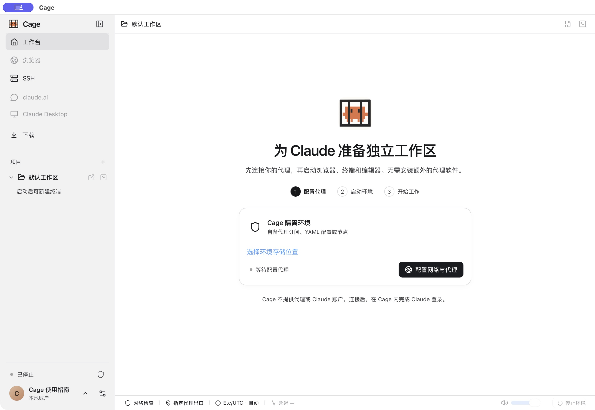

## 打开项目与编辑文件

终端和工具运行在你选择的客机系统里。macOS 使用 Mac 工具链，Windows 使用 PowerShell 与 Windows 工具，Debian 使用 Linux 工具；浏览器、编辑器和 Claude Desktop 都从同一个工作台进入。系统组合与安装方式见[选择客机系统](guest-systems.md)。

点击左侧“项目”旁的加号，选择已有项目，或点“添加本机项目…”打开主机目录。没有项目时也可使用默认工作区。项目列表会保存，下次启动继续可用。

在项目选择窗口选中已添加的目录，点击“从 Cage 移除此项目”并确认，可解除共享并从列表移除。请先保存文件并关闭该项目的终端、运行中会话和编辑器。原文件与会话历史保留，重新添加相同目录后可继续使用历史。移除当前项目后选中默认工作区，默认工作区始终保留。环境停止时也可打开项目选择窗口移除目录。

项目旁的打开图标（↗）在 code-server 中编辑该目录，终端图标（>_）用于选择终端类型。文件会直接写入共享目录，重要项目请先备份；项目内的 `.git` 可读写，可直接在 Cage 中暂存、提交和切换分支。

所有项目共用一个环境、工具和账户。切换项目不会改变已有终端的目录，也不会关闭网页或撤销之前的共享。云端的目录与权限见[云端部署与 SSH](cloud.md)。

共享文件在环境内显示为当前用户所有，Git 可正常读取已打开项目的状态与历史。文件内容仍属于原来的主机目录，Git 元数据与项目一起共享，环境中的 Git 操作会直接更新主机仓库。授权目录内的隐藏文件、工具配置、Git 配置和钩子均按普通项目文件共享。Cage 不按文件名额外隐藏文件或禁止写入；云端共享的整目录只读授权仍然生效。

<figure class="guide-shot">
  
  <figcaption>工作台侧栏、默认项目与终端入口（环境未启动）。截图版本：0.1.6-alpha-preview（开发构建） · macOS 原生应用 · 2026-11-07。<a href="../../www/public/docs/screenshots/first-start.jpg" target="_blank" rel="noopener">查看原图（2560 × 1764） ↗</a></figcaption>
</figure>

## 新建 Claude 终端

1. 点击项目旁的终端图标，选“新建 Claude 终端”。Cage 会在该目录启动 `claude`。
2. 首次使用按官方提示登录，授权页面在 Cage 浏览器中完成。主机已有的 Claude 登录不会自动导入。
3. 有多个订阅时，先按[多账号与额度](accounts.md)登记；新建的 Claude 终端标签会显示分配的账号。

Claude Code 标签使用 Agent 图标，带编号时表示该会话绑定的账号编号；普通终端继续使用终端图标。账号分配与跨账号接续由[账号设置](accounts.md#在同一会话中换账号)管理，图标本身不切换身份。

Cage 的共享 Claude 会话会先显示“正在准备 Claude 会话…”，在后台确认自身通道的启动提示，再显示会话画面。需要查看登录或排错信息时，点击“显示启动过程”；准备超过 8 秒会自动显示终端，避免卡住的提示被隐藏。普通终端仍直接显示输出。

也可创建普通终端，自行运行 shell 命令。在“设置 → 通用 → Claude 终端启动命令”添加参数，例如 `claude --continue`。只对以后新建的 Claude 终端生效，退出 Claude 后 shell 仍可使用。

移动端的结构化会话与普通终端分别管理，详见[手机会话范围](mobile.md#创建会话与处理工具审批)。

历史列表提示读取失败时，已经显示的历史继续保留，旧的活跃标记会清除。点击重试按钮核对最新状态；正在读取时按钮禁用，原因仍可复制。持续失败请按[会话读取故障](troubleshooting.md#claude-登录与账号异常)检查环境连接与诊断信息。

## 管理标签与分屏

鼠标移入终端行或用键盘聚焦后，可置顶、重命名或删除。网页标签可右键或按 Shift+F10 打开菜单；拖动可在同一列表排序，Esc 取消拖动，刷新保留顺序。页面过多时用向下箭头搜索已打开的网页。

工作台支持网页与终端组合使用；普通网页也支持双页分屏。无痕网页可与终端分屏，双网页分屏仅支持普通标签。浏览器右上角 × 返回之前的工作区，已打开的网页和登录状态保留。

macOS 用 `⌘1–9` 切换当前网页或当前目录的终端；Windows/Linux 工作台对应使用 Ctrl。终端中的 Ctrl+C 始终用于中断命令。

## 上传、下载与附件

网页选择上传文件时，会显示“上传本机文件”，点击“选择本机文件”调用系统窗口。一次最多 100 个文件，单文件最多 2 GB；网站还可能有更小限制。只传递选中的文件，不会因此共享整个文件夹。取消、刷新或关闭原网页后需重新选择。

可以把图片、视频、文档拖到支持附件的目标，或在文件管理器复制后到 Cage 粘贴。终端会把附件存入客机目录并插入带引号的路径，供 Claude Code 读取，不自动执行。截图粘贴最多 20 MB、4000 万像素；文件传输不使用外部存储中转。

下载在 Cage 环境内完成。本机模式的完整文件先保留在默认工作区 `Downloads`，同名自动换名；工作台观察到完成后弹出“另存为”。取消仍保留默认位置的文件。在左侧“下载”或浏览器下载按钮可查看进度、打开、显示文件位置或另存。

云端文件和已经另存到本机的副本分开记录。要在其他应用打开远端文件，先明确保存到本机。

## 输入法与剪贴板

先点击目标输入位置，再复制或粘贴。macOS 终端用 `⌘C/V`，Windows/Linux 终端用 `Ctrl+Shift+C/V`。Cage 桌面应用中的 Claude 终端还支持 `Ctrl+V` 粘贴本机剪贴板里的截图或文字。图片会保存到客机并插入可供 Claude Code 读取的路径；传递完成前按 Enter 会等待，传递失败则取消这次待发送操作。普通网页、编辑器和本机输入框按所选键盘习惯操作；“设置 → 通用”可调整。

Claude Code 自己管理的选区和 `/copy` 发出的文字复制会写入本机剪贴板，并参与现有共享剪贴板同步。终端重连时只恢复历史画面，不重复执行旧的复制。终端程序接管鼠标时，也可在 Mac 按住 Option 拖选，Windows/Linux 按住 Shift 拖选，再复制。Ctrl+C 保持终端中断行为。普通浏览器因权限限制无法使用剪贴板时，可用“文本传递”面板传纯文本。

Cage 桌面应用运行 Linux 客机时，本机、Cage 浏览器和 Claude Desktop 双向共享文字、图片、文件和文件夹的剪贴板。点击应用内的复制按钮后可直接在另一端粘贴；切换画面与窗口失焦继续共享。拖选文字仅改变选区，复制后才更新共享内容。范围、大小限制与文件保留规则见 [Claude Desktop：复制与粘贴](desktop.md#复制与粘贴)。

普通网页工作台中的复制按钮支持把纯文本同步到本机，保持网页和窗口在前台，等待“已复制到本机”。切换标签或输入位置可能取消尚未完成的传递，重新复制即可。

## 关闭、锁定与退出

| 操作 | 对任务的影响 |
| --- | --- |
| 关闭或隐藏窗口 | 环境、终端、网页和下载继续运行。不可见时暂停画面显示连接，返回后重连。 |
| 锁定 Cage | 隐藏工作台并要求验证，已运行的任务继续。手机的受保护操作暂停。 |
| 退出应用时选择保留环境 | 后台任务继续，下次打开重新连接。 |
| 停止环境或退出账户 | 结束运行中的终端，项目、磁盘和登录资料保留。 |
| 刷新工作台 | 可重连后台仍存活的终端。 |
| 重启控制服务或环境 | 旧终端进程不能恢复，需要新建。 |

停止前保存编辑器内容。磁盘里保存的文件与 Claude 历史，不等于能恢复已结束的进程和终端临时输出。
