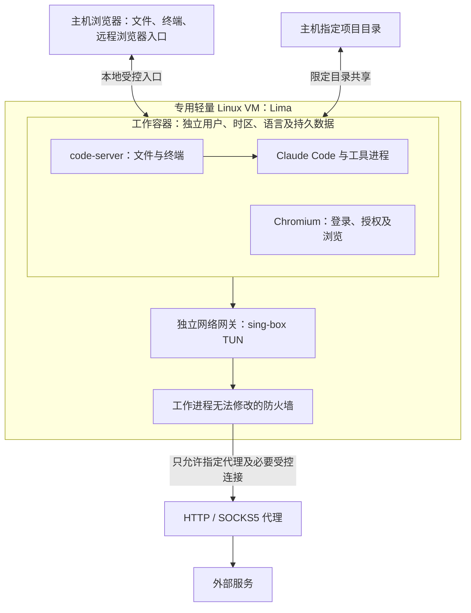

# Claude 防封 选型调研

查询日期：2026-10-30。本文面向项目发起人，供选择实现路线使用。结论来自官方文档、项目仓库及仓库目录检查；未安装候选软件，未进行 Claude 登录、代理故障或资源占用实测。

目标是在 macOS 上提供一个可隔离的开发环境，用户只使用文件、CLI 和浏览器，不需要完整桌面。Claude Code 本体、它启动的工具、登录浏览器和授权回调均留在环境内；时区、系统语言和浏览器语言单独配置；外部通信只允许经过用户指定的 HTTP / SOCKS5 代理；项目目录与主机共享。

**可行，已有接近成品的方案。功能上最接近的是 AIO Sandbox；针对基于开源项目二次开发的要求，当前优先评估 agent-vm。** 它已集成 Lima、Claude Code、共享目录和网页编辑器，具体源码证据、缺口及建议见[二次开发选型](2026-10-30-agent-vm-assessment.md)。本文保留各组件和替代路线的综合比较。

## 用户实际使用的环境

打开一个本地 Web 入口，即可访问项目文件、运行 Claude Code，并切换到 cage 内的浏览器完成登录。主机浏览器承载编辑器界面及远程浏览器画面；访问登录网站、保存 Cookie 和接收授权回调的浏览器进程运行在 cage 内。

这是建议架构，尚未实现。图中的 VM 可以没有桌面系统。交互式浏览器仍需要最小显示服务及画面传输组件，但不必安装完整桌面套件。LinuxServer 的 Chromium 镜像已有通过 Selkies 向浏览器传输单应用界面的路径，可作为参考。[单应用浏览器文档](https://docs.linuxserver.io/images/docker-chromium/)

## 现有项目与适配程度

| 项目 | 已有能力 | 对本需求的缺口与判断 |
|---|---|---|
| [AIO Sandbox](https://github.com/agent-infra/sandbox) | 在同一容器中集成 Chromium、可交互浏览器画面、终端、文件、VS Code Server 和 MCP | 功能最接近，可先做概念验证；需要补强制出口、Claude 登录集成及权限边界。公开仓库标注 Apache-2.0，但完整镜像自行构建能力仍有缺口，见下文 |
| [code-server](https://github.com/coder/code-server) | MIT 开源，提供浏览器中的 VS Code，可承载文件操作和开发终端 | 适合做精简入口；自身不提供 VM 隔离、独立登录浏览器和防泄漏网络 |
| [OpenVSCode Server](https://github.com/gitpod-io/openvscode-server) | 将 VS Code 放在服务器运行，通过浏览器访问 | 同类入口备选；隔离、浏览器和网络需要另外组合 |
| [Docker Sandboxes](https://docs.docker.com/ai/sandboxes/) | 每个 sandbox 使用独立 Linux 内核的 microVM，支持 Claude 和主机工作目录共享 | 现成隔离底座候选；HTTP/SOCKS5 上游支持仍标为实验性，浏览器登录默认便利功能涉及主机浏览器，需要定制与验证 |
| [Kasm Workspaces](https://docs.kasm.com/docs/1.18.0/guide/egress) | 容器化浏览器、桌面、会话管理和 VPN 出口 | 更偏多用户工作空间平台；当前单机、无桌面需求无需优先采用。原生 VPN 路线也不直接匹配本次 HTTP/SOCKS5 出口 |
| [UTM](https://github.com/utmapp/UTM) | macOS 虚拟机管理、图形操作及共享目录 | 可以承载完整环境；更适合手工管理 VM，当前形态优先考虑可编排的 Lima |
| [ClaudeCage](https://github.com/PACHAKUTlQ/ClaudeCage) | 面向 Claude Code 的便携命令行沙箱 | 仓库已于 2026-10-16 归档；未覆盖本次完整 Web 开发环境与强制代理要求，不选作底座 |

表中适配排序是本次需求下的判断。Docker 的 microVM 与网络边界参见[隔离文档](https://docs.docker.com/ai/sandboxes/security/isolation)，目录共享参见[架构文档](https://docs.docker.com/ai/sandboxes/architecture/)，代理条件参见[上游代理文档](https://docs.docker.com/ai/sandboxes/configuration/upstream-proxy/)。Kasm Workspaces 的商业平台许可和开源组件需要分别判断：[平台许可](https://docs.kasm.com/docs/1.19.0/reference/license)、[开源 KasmVNC](https://github.com/kasmtech/KasmVNC)。

## AIO Sandbox：最接近现成产品的候选

官方说明明确支持在同一容器中共享文件系统，同时提供浏览器、Shell、文件操作和 VS Code Server。浏览器下载的文件可以直接被终端和文件接口读取；用户可通过 VNC 入口操作浏览器，通过 code-server 入口处理代码。[功能说明](https://sandbox.agent-infra.com/guide/start/introduction)

与本需求相关的现成配置包括：

- 设置工作目录并挂载主机项目目录。[工作目录](https://sandbox.agent-infra.com/guide/advanced/workspace)
- 设置浏览器语言、界面语言和启动参数。[浏览器配置](https://sandbox.agent-infra.com/guide/advanced/browser-config)
- 通过 `DISABLE_JUPYTER` 停止不需要的 Jupyter 服务；停用服务不代表镜像体积随之缩小。[环境配置](https://sandbox.agent-infra.com/guide/advanced/env-config)
- 将 agent 本体运行在容器内，与浏览器、文件和工具共享同一执行环境。[Agent In Sandbox](https://sandbox.agent-infra.com/guide/start/agent-sandbox)
- README 的 Compose 示例包含 `TZ` 配置；发行说明 v1.11.0 写明恢复原生 arm64 镜像构建支持。选用时仍应核对固定镜像标签的实际架构。[README](https://github.com/agent-infra/sandbox)、[发行说明](https://github.com/agent-infra/sandbox/releases)

它尚不能直接被认定为满足全部隔离要求。官方代理说明提供 `PROXY_SERVER` 以及代理排除项，没有给出覆盖所有进程、所有协议、启动和故障阶段的禁止直连保证。安全说明也将默认用途定位为可信本地开发。[代理说明](https://sandbox.agent-infra.com/guide/advanced/proxy-network)、[安全说明](https://sandbox.agent-infra.com/guide/advanced/security)

另一个实质性限制是源码完整性：本次检查公开仓库 `main` 的文件树，`docker/` 只有 `.gitkeep`，没有找到 Dockerfile 或完整运行服务端实现。公开仓库的 Apache-2.0 标识不能单独证明预制镜像的全部运行组件都可从此仓库重建。因此，它适合先评估使用体验；若要求全部关键组件可审计、可自行构建，应先解决这个缺口。[公开 docker 目录](https://github.com/agent-infra/sandbox/tree/main/docker)、[本次检查用仓库文件树 API](https://api.github.com/repos/agent-infra/sandbox/git/trees/main?recursive=1)

## 更精简、可掌握的组合路线

建议以专用 Lima VM 为 macOS 上的底座，里面运行工作容器与独立网关。工作容器放 code-server、Claude Code、Chromium 及必要的图形传输组件，避免装入整套桌面、Notebook 和额外 agent 服务。Lima 是开源 Linux VM 管理工具，支持自动文件共享；在 macOS 的 VZ 后端可使用 virtiofs。已有 Colima 也可作为容器运行底座备选，需建立独立实例并收紧默认挂载。[Lima 仓库](https://github.com/lima-vm/lima)、[共享目录](https://lima-vm.io/docs/config/mount/)、[Colima](https://github.com/abiosoft/colima)

code-server 与 OpenVSCode Server 只承担用户入口。把它们直接安装在主机上，并不会形成底层隔离。LinuxServer Chromium/Firefox 镜像和 Selkies 可提供单应用画面传输，选用前需核对运行权限、浏览器自身沙箱和所选标签的实际组件。[code-server](https://github.com/coder/code-server)、[OpenVSCode Server](https://github.com/gitpod-io/openvscode-server)、[Chromium](https://docs.linuxserver.io/images/docker-chromium/)、[Firefox](https://docs.linuxserver.io/images/docker-firefox/)

这条路线的开发工作集中在启动配置、挂载白名单、浏览器启动与授权衔接、持久数据，以及网络验收；无需重写编辑器、终端或浏览器。当前不建议为单机需求引入多用户调度平台或 Kubernetes。

## HTTP / SOCKS5 出口如何兜底

sing-box 提供 TUN 入口、HTTP 出站和 SOCKS 出站，可以作为这次代理网关的候选。普通 HTTP CONNECT 主要承载 TCP；SOCKS5 的 UDP 是否可用取决于实际服务端及配置。TUN 不会凭空补齐上游协议能力。对上游不支持的流量应拒绝，不允许自动转为主机直连。[TUN](https://sing-box.sagernet.org/configuration/inbound/tun/)、[HTTP 出站](https://sing-box.sagernet.org/configuration/outbound/http/)、[SOCKS 出站](https://sing-box.sagernet.org/configuration/outbound/socks/)

以下是建议实现条件，不能从“已设置代理”或“已启用 TUN”推导为已经成立：

1. 工作容器没有第二条可用的公网出口。外部防火墙默认拒绝，网关只放行到指定代理端点的必要连接。
2. Claude、浏览器及其子进程不能修改网关或防火墙。工作容器不授予网络管理能力，不暴露容器引擎控制 socket；网络管理权限仅属于网关。
3. 防火墙先于工作服务生效。代理退出、配置错误、认证失败、TUN 消失或 VM 重启时保持禁止直连。
4. DNS 查询同样通过指定代理链处理，例如经代理访问 DoH；IPv6、UDP、QUIC 和 WebRTC 必须纳入覆盖或阻断。代理服务器域名自身的解析也要确定启动策略，不能暗中放宽为任意直连 DNS。
5. 本地 UI 与授权回环属于明确允许的内部通信。允许主机访问 cage 的 UI，不应扩大成 cage 可主动访问所有主机服务或局域网。
6. 如果指定代理本身轮换出口 IP，cage 无法仅凭固定代理地址保证固定公网 IP；还需代理供应方提供固定出口，并实测。

“绝对兜底”的可验收含义应为：在约定权限和可信底座内，启动、运行及故障阶段均无非指定出口。它不包含主机管理员主动解除防护、内核漏洞等无限威胁范围。

Gluetun 的内置防火墙具备 VPN 断线保护，但其主要上游是 OpenVPN/WireGuard；内置 HTTP 代理是让其他程序接入 Gluetun 的入口，不能据此认定它能把任意 HTTP/SOCKS5 代理当 VPN 出口。本次无需优先采用。[Gluetun](https://github.com/passteque/gluetun)、[防火墙说明](https://github.com/qdm12/gluetun-wiki/blob/main/faq/firewall.md)

## 登录、系统信息与文件共享的边界

Claude Code 应直接运行在 cage 内，浏览器和本地 MCP 服务也位于同一隔离范围。仅让主机 Claude 调用 cage 的工具，不能覆盖 Claude 自身的请求与系统信息读取。Claude 官方内置沙箱主要限制工具命令，文档明确列出了在其之外运行的本体功能、工具和服务，因此不够单独满足本需求。[Claude 沙箱边界](https://code.claude.com/docs/en/sandboxing)

登录 URL 应在 cage 内的真实浏览器打开。最简单的授权衔接是让 CLI 与浏览器共享网络命名空间，使浏览器的 `localhost` 能到达 CLI 回调；如果分开容器，应显式安排回调路径或使用官方支持的手动授权码流程，并仍在 cage 内浏览器登录。不能默认点击终端链接后由主机浏览器完成授权。[Claude 登录故障说明](https://support.claude.com/en/articles/14552646-troubleshoot-claude-code-installation-and-authentication)

独立时区与语言可通过 guest 系统配置、locale 和浏览器语言设置实现，需要同时检查终端及浏览器实际值。时区独立不意味着需要让系统时钟偏离真实时间。Linux VM 也不提供“任意硬件信息都可伪装”的保证；可见 CPU 特征、浏览器特征及应用自身标识需要按实际需求检查。目标可定义为隔离主机用户数据、进程环境和凭据，不能直接扩展为“外部服务无法关联身份”。

文件共享应只开放指定项目路径，并将浏览器用户目录、Claude 凭据和 cage 家目录放入专用持久存储。Lima 文档的默认挂载包括只读主机家目录，严格隔离部署需要显式替换，不能直接沿用。[Lima 默认配置](https://lima-vm.io/docs/config/)

可写共享目录中的删除、修改会真实影响主机文件，这是共享的预期效果。项目里的脚本与 Git 配置也会被共同修改；主机后续执行这些内容仍会产生主机侧效果。macOS 与 Linux 的文件权限、大小写、文件监听和依赖二进制差异需用实际项目验证，尤其不应直接混用两个系统的编译产物和依赖目录。[Lima 挂载及文件监听限制](https://lima-vm.io/docs/config/mount/)

## 下一步建议与验证范围

二次开发底座优先按[agent-vm 源码评估](2026-10-30-agent-vm-assessment.md)推进选型；AIO Sandbox 用于参考完整体验。本文中的独立组件组合仍可作为替代方案，具体采用尚待确定。

后续最小验证应覆盖这些真实行为：

| 验证项 | 通过条件 |
|---|---|
| 完整登录 | cage 内 Claude 发起登录、cage 内浏览器完成授权、回调成功、发送一次实际请求；主机浏览器不直接访问授权站点 |
| 出口一致 | CLI、浏览器和子进程均经指定代理；抓包检查非代理目标的连接尝试 |
| 故障断网 | 停代理、错误凭据、删除 TUN、重启网关及冷启动时均无直连；恢复后能重新工作 |
| 协议覆盖 | DNS、IPv6、UDP/QUIC、WebRTC 与绑定网卡的连接都符合允许或阻断策略 |
| 权限边界 | 工作进程不能修改外部网关、访问主机引擎 socket、未共享主机目录或其他 cage |
| 本地设置 | 终端和浏览器分别核对时区、locale、语言、家目录及机器标识 |
| 文件与持久化 | 两侧修改项目文件可见；重启后 cage 登录态保留；非授权目录不可见 |

以上均为待验证事项。本次调研未证明任何组合已经通过完整验收，也未测量启动耗时、内存或文件 IO 性能。
